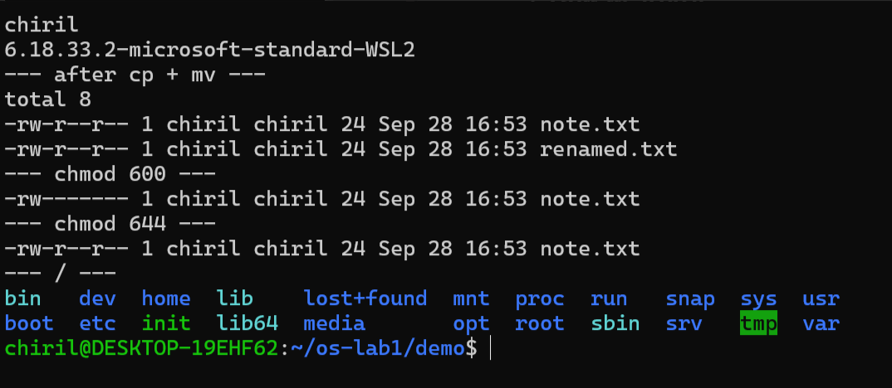
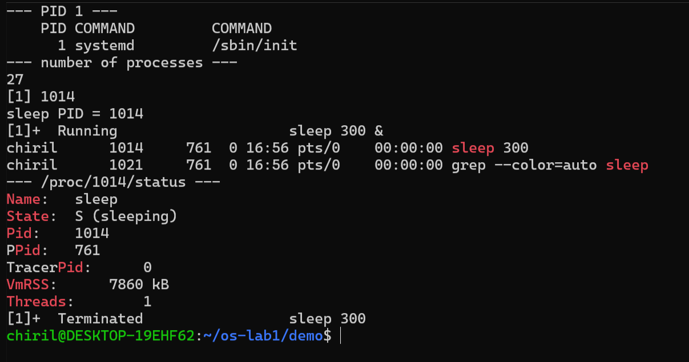
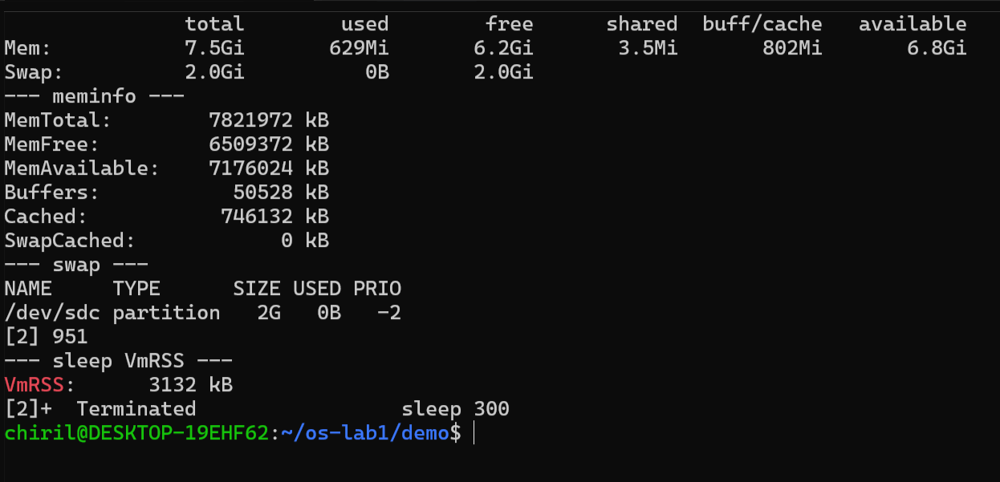
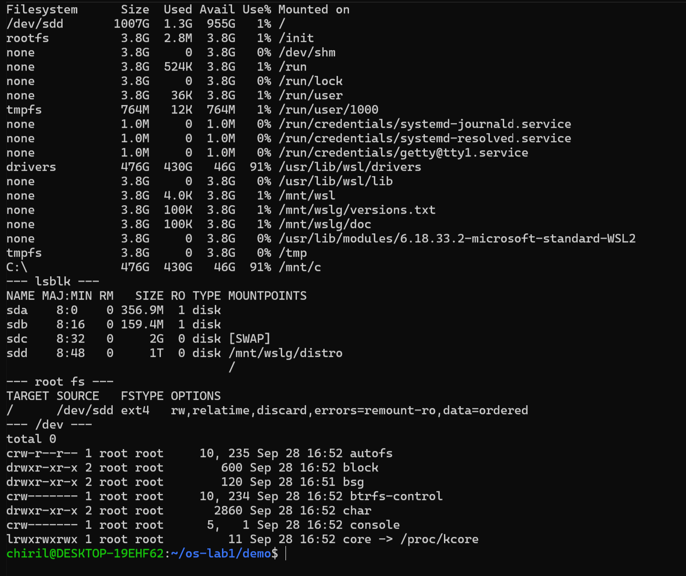

# Operating Systems Labs

Macari Chiril-Adam, FAF-243

---

# Lab 1 – The OS as a Resource Manager

## Purpose of the work

The purpose of this lab is to see the operating system at work as a resource manager. By running commands in a Linux terminal, I looked at how the OS manages the four core resources (files, processes, memory and devices) and wrote down what I observed.


## Setup

I did this lab on my own laptop, using Ubuntu in WSL 2 (Windows Subsystem for Linux) instead of VirtualBox.

- user: `chiril`
- machine: `DESKTOP-19EHF62`
- kernel: `6.18.33.2-microsoft-standard-WSL2`

WSL 2 still runs a real Linux kernel, just inside a small virtual machine made by Microsoft, so some outputs (like PID 1 or the disk names) look a bit different than on a normal VM.

---

## Part 1. Files and directories




**1. Who owns the files you just created, and which group?**

The owner is `chiril` and the group is also `chiril`. When Ubuntu creates a user it also creates a group with the same name, so every file I make gets my user and my group.

**2. What do the ten characters at the start of `ls -l` mean for note.txt after chmod 600?**

After `chmod 600` I got `-rw-------`:
- `-` means it is a normal file (a directory would have `d`)
- `rw-` means the owner (me) can read and write, but not execute
- `---` means the group can't do anything
- `---` means others can't do anything

So 600 means only I can read and change the file (6 = 4 read + 2 write, 0 for group and others). After `chmod 644` it went back to `-rw-r--r--`, so others could read it again.

**3. Name two directories directly under / and say what they hold.**

- `/etc` has the configuration files of the system (all plain text files)
- `/home` has the home folders of the users, mine is `/home/chiril`

Other ones I recognized: `/proc` (live info about processes and the kernel) and `/dev` (device files).

**Interesting output:**
```
--- after cp + mv ---
-rw-r--r-- 1 chiril chiril 24 Sep 28 16:53 note.txt
-rw-r--r-- 1 chiril chiril 24 Sep 28 16:53 renamed.txt
```
Both files have 24 bytes ("hello operating systems" + the newline). `mv` didn't actually copy anything, it just renamed the file. I also noticed there is a file called `init` directly in `/`, which is the WSL init program from Microsoft.

---

## Part 2. Processes




**1. What is the PID of process number 1, and what is it?**

```
PID COMMAND   COMMAND
  1 systemd   /sbin/init
```
PID 1 is `systemd` (started as `/sbin/init`). It is the first process the kernel starts after booting. It starts all the other services, and if a process loses its parent, systemd adopts it. Basically all other processes come from it.

**2. Roughly how many processes were running on your idle VM?**

`ps aux | wc -l` gave 27, but the first line is the header, so there were about 26 processes. That's very few, because WSL only starts the minimum. A normal Ubuntu desktop has a few hundred.

**3. From /proc/\<pid\>/status, what does the "State:" line say for your sleeping process?**

It says `State: S (sleeping)`. The process is waiting for its 300 seconds to pass and doesn't use the CPU during this time.

**Interesting output:**
```
Name:    sleep
State:   S (sleeping)
PPid:    761
Threads: 1
```
`PPid: 761` is my bash shell. In `ps -ef | grep sleep` both `sleep` (PID 1014) and `grep` (PID 1021) had the parent 761, so the shell created both of them. After `kill`, `jobs` showed `Terminated sleep 300`, so the OS really stopped the process.

---

## Part 3. Memory




**1. How much total RAM does the VM have, and how much is free?**

```
       total   used    free   shared  buff/cache  available
Mem:   7.5Gi   629Mi   6.2Gi  3.5Mi   802Mi       6.8Gi
Swap:  2.0Gi   0B      2.0Gi
```
Total RAM is 7.5 GiB (`MemTotal: 7821972 kB`) and 6.2 GiB is free. "Available" is bigger (6.8 GiB) because Linux uses around 800 MiB as cache and can free it if a program needs it. WSL 2 takes about half of the laptop's RAM by default.

**2. What is swap, and how much is configured?**

Swap is space on the disk that the OS uses as extra memory. When RAM is full, the kernel moves pages that are not used right now to the disk. It is much slower than RAM, so it's more like a backup. I have 2 GiB of swap on `/dev/sdc`, and 0 B is used because RAM is almost empty.

**3. How much resident memory (VmRSS) does a bare sleep process use, and does that surprise you?**

`VmRSS: 3132 kB`, so about 3 MB (in Part 2 I got around 7.8 MB for the same thing). It surprised me a bit, because `sleep` doesn't do anything. But VmRSS counts everything that is loaded in RAM for the process, not only its own code, for example the C library (libc) and the loader. A lot of that memory is shared with other processes, so every new `sleep` doesn't really cost 3 MB more.

---

## Part 4. Devices and storage




**1. Which device is your root filesystem "/" mounted on?**

```
TARGET SOURCE   FSTYPE OPTIONS
/      /dev/sdd ext4   rw,relatime,discard,errors=remount-ro,data=ordered
```
`/` is mounted on `/dev/sdd` and the filesystem is ext4. `lsblk` shows `sdd` as a 1 TB disk, but only 1.3 GB is used. It's a virtual disk that WSL keeps as a file on Windows and it only grows when needed.

**2. Give one entry from /dev and say what real thing it stands for.**

`/dev/sdd` is the (virtual) disk that has my whole Linux system on it. Another one is `/dev/console` (`crw------- ... 5, 1`), which is the system console, the terminal where the kernel prints its messages. The first letter shows the type: `c` is a character device (read byte by byte, like a terminal) and `b` is a block device (like a disk). Also, instead of a size, device files have two numbers (like `5, 1`) that tell the kernel which driver to use.

**3. In one sentence: what does "everything is a file" mean, based on what you saw?**

In Linux, disks, terminals, processes and even memory info all show up as files in the same folder tree, so I could look at all of them with the same commands (`ls`, `cat`, `grep`) without needing a special tool for each one.

**Interesting output:**
```
C:\     476G  430G  46G  91%  /mnt/c
```
My Windows C: drive shows up in Linux as a normal folder, `/mnt/c`, even though it's a completely different filesystem.

---

## Conclusion (Lab 1)

The OS manages four resources: files (I saw them with `ls -l` and changed permissions with `chmod`), processes (`ps aux` to list them and `kill` to stop them) and memory (`free -h` and `/proc/<pid>/status`). It also manages devices and storage, which I saw with `lsblk` and `df -h`. In all four cases the OS is between my programs and the hardware, it decides who can use what, and it shows everything as files.

---
---
