# Lab 10 – Add Your Own System Call: trace (xv6)

## Purpose of the work

The purpose of this lab is to change the kernel for the first time and add a new system call to xv6. The system call is called `trace`: it makes a process print every system call that it makes, like `strace` did for me in Lab 9, but this time I build it myself. In the lab I follow one number, 23, from a user program down to a function in the kernel.

I worked in my xv6 tree `~/xv6-riscv` (revision `06aad25`) in Ubuntu in VirtualBox, and I started xv6 with `make qemu CPUS=1` as in the earlier labs. The sheet says that our xv6 is newer than the one in the MIT instructions: number 22 is already `sync`, and the kernel print function is called `printk`. I checked this in my tree before starting, and `SYS_sync` is 22 and `printk` exists, so I used 23 and `printk` as in the sheet.

## Part 1. The number and the user side

A system call has to be added in five places on the user side. I made the edits with a short list of commands (the output of the commands is in the figure):

- `kernel/syscall.h`: the new line `#define SYS_trace 23`.
- `user/user.h`: the declaration `int trace(int);` after `int sync(void);`.
- `user/usys.pl`: the line `entry("trace");`. At build time this script creates `user/usys.S`, where `trace` becomes three instructions: `li a7, SYS_trace`, `ecall` and `ret`.
- `user/trace.c`: the program. It sets the mask on itself with `trace(atoi(argv[1]))` and then becomes the command with `exec`. The mask stays because `exec` keeps the same process.
- `Makefile`: the line `$U/_trace\` in `UPROGS`, after `$U/_zombie\` (it starts with a TAB).

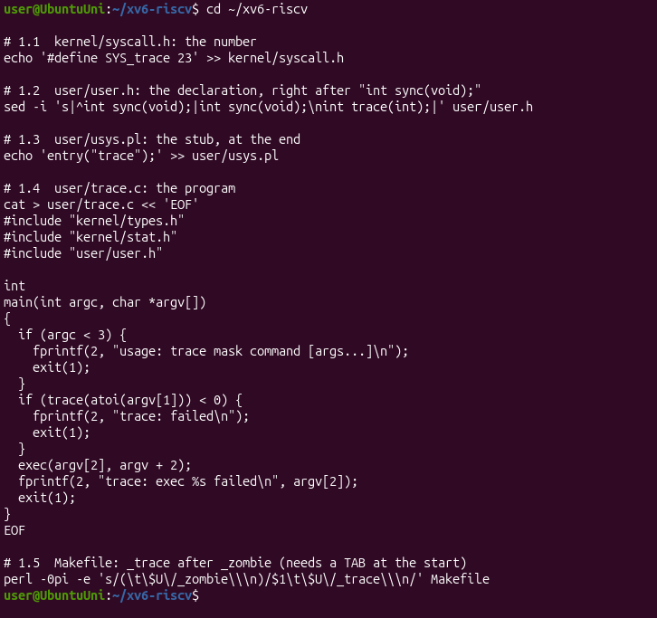

To be sure that all the edits are in place I looked at the end of `syscall.h` and searched for `trace` in the other files:

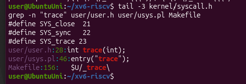

**Check 1.** I started xv6 and ran `trace 32 grep hello README`. The kernel has no function for number 23 yet, so it has to complain, and it did exactly as the sheet says:

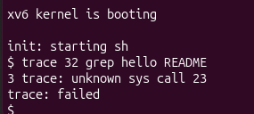

This message is good news. It means that my program ran `ecall` with `a7 = 23` and the kernel received it. The message comes from the `else` branch of `syscall()` in the kernel, which prints `unknown sys call` when there is no function in the table for that number. Then `trace()` returned -1, and my program printed `trace: failed`.

## Part 2. The kernel side

Now the kernel has to know what to do with number 23. There are five edits:

- `kernel/proc.h`: a new field `int trace_mask;` in `struct proc`, after the name. Every process remembers its own mask.
- `kernel/sysproc.c`: the handler `sys_trace()`. It reads argument 0 (register `a0`) with `argint` and stores it in `myproc()->trace_mask`.
- `kernel/syscall.c` (table): the line `extern uint64 sys_trace(void);` and the entry `[SYS_trace] = sys_trace` in the table of functions, so that number 23 points to my function.
- `kernel/syscall.c` (names and print): a table `syscallnames[]` with the names of all calls, above `syscall()`, because the kernel only knows numbers. Inside `syscall()`, right after the line that runs the call, I added: `if ((p->trace_mask >> num) & 1) printk(...)`. It is after the call, so the return value in `a0` is already there.
- `kernel/proc.c`: in `fork()`, the line `np->trace_mask = p->trace_mask;`, so the children inherit the mask.

I applied the edits with a small Python script that stops with an error if one of the places is not found, so that nothing is applied half. It printed `ok` for the four files:

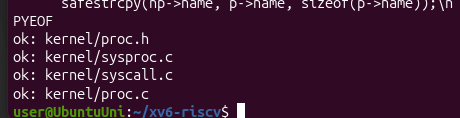

The result of the five edits is in `git diff` (it is longer than one screen, so there are two parts):

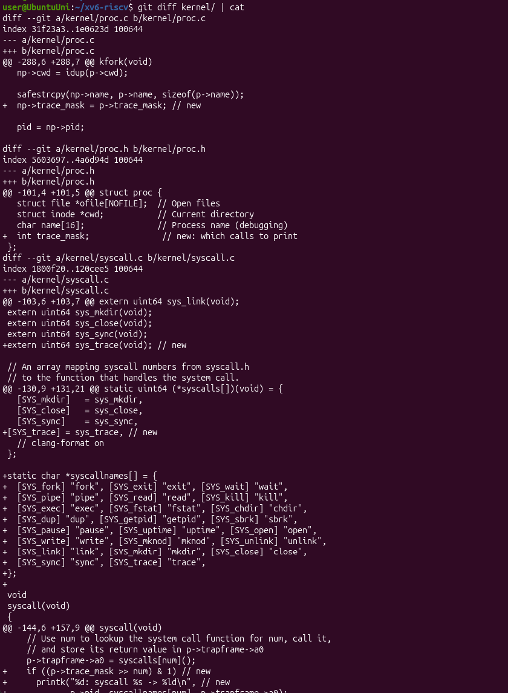

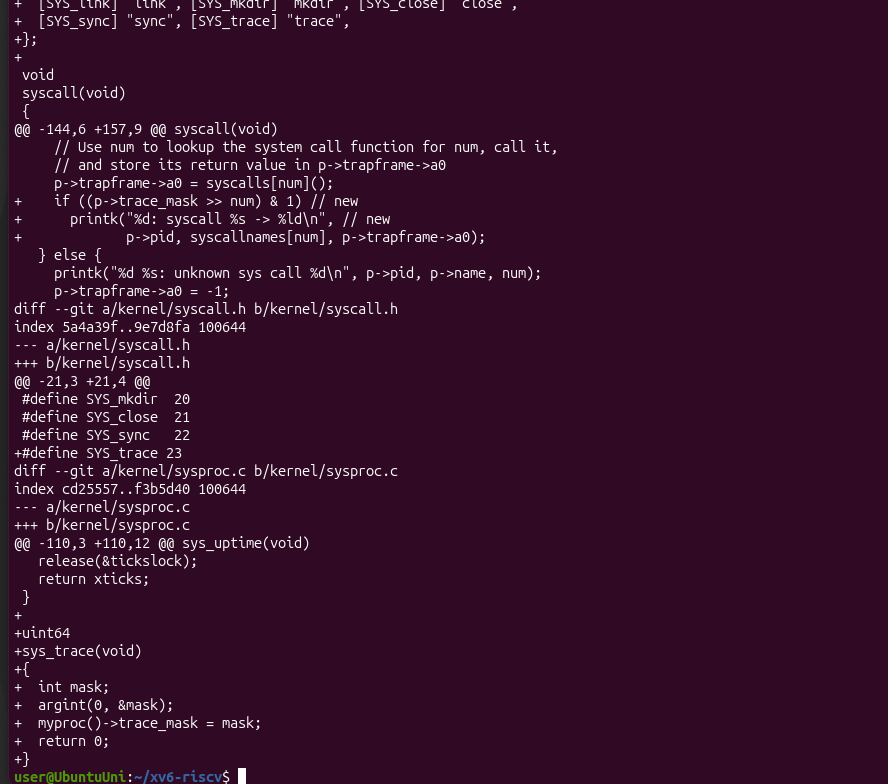

**Check 2.** I restarted xv6 (`make qemu CPUS=1`) and ran `trace 32 grep hello README`:

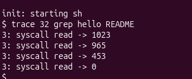

The numbers are exactly the ones from the sheet: 1023 + 965 + 453 = 2441, which is the size of `README`, read in three pieces, and then 0 for the end of the file. The pid is 3 in my run.

## Part 3. Play with the mask

The mask is a number that I read in binary: if bit N is on, the call number N is printed. For example `32 = 2^5` and 5 is `SYS_read`, so only the `read` calls were printed in Check 2.

**3.1 All the calls.** The mask 2147483647 is `2^31 - 1`, so all the bits are on:

```
trace 2147483647 grep hello README
```

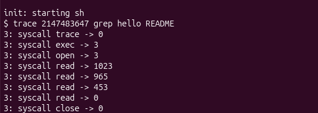

The first line is `syscall trace -> 0`: the mask is set inside the call `trace` itself, so when this call returns, its own line is already printed. After it come `exec -> 3` (the return value of `exec` is the number of arguments, `grep hello README` has 3), `open -> 3` (the descriptor of `README`), the four `read` calls and `close -> 0`.

**3.2 Only fork.** The mask 2 is `2^1` and 1 is `SYS_fork`. I ran it on the test `forkforkfork`, which forks until the process table is full:

```
trace 2 usertests forkforkfork
```

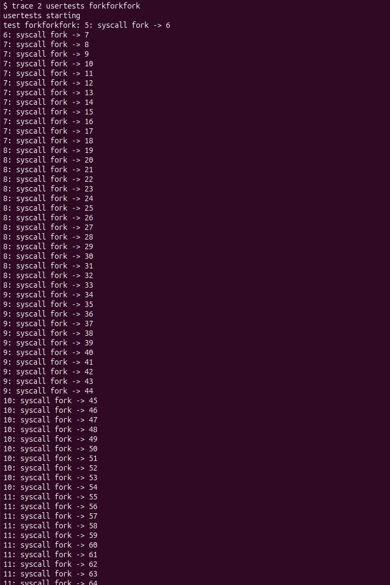

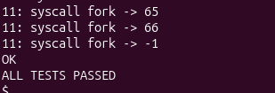

The lines are printed by many different pids (5, 6, 7, 8, 9, 10 and 11 in my run). At the end `fork -> -1` means that the kernel had no free place in the process table, and the test finished with `OK` and `ALL TESTS PASSED`.

**3.3 Only write.** The mask 65536 is `2^16` and 16 is `SYS_write`:

```
trace 65536 echo hi
```

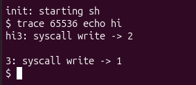

**3.4 Only open and close (Observe 4).** I calculated the mask for `open` (call 15) and `close` (call 21) by adding the two bits: `2^15 + 2^21 = 32768 + 2097152 = 2129920`.

```
trace 2129920 grep hello README
```

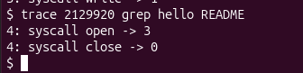

Only `open -> 3` and `close -> 0` are printed, so the mask is correct.

**Observe**

**1. In trace 32 grep hello README why do you see only read, and not open or close?**

`grep` also calls `open` and `close`, but the kernel prints a call only if its bit is on in the mask. The mask 32 is `2^5`, so only bit 5 is on, and 5 is `SYS_read`. `open` is call 15 and `close` is call 21, so their bits are off and their lines are not printed. With all the bits on (3.1) they appear: `open -> 3` and `close -> 0`.

**2. In forkforkfork, three different pids print lines. Which line of code from Part 2 makes that possible?**

The line `np->trace_mask = p->trace_mask;` in `fork()` (`kernel/proc.c`, edit 2.5). The mask is stored in the `struct proc` of one process. Without this line the new child would start with a mask of 0 and would not print anything. With it, every child inherits the mask of its parent, so the children, and the children of the children, call `fork` and are traced too, with their own pids.

**3. In trace 65536 echo hi the trace line is printed between "hi" and the new line. Why? How many times does echo call write?**

`echo` calls `write` **two times**: first `write(1, "hi", 2)` for the word, then `write(1, "\n", 1)` for the new line. The kernel prints the trace line right after each call ends. So the first line (`syscall write -> 2`) appears just after `hi` and before the new line is written, and the second line (`syscall write -> 1`) comes after the new line. That is why my screen shows `hi3: syscall write -> 2` and then `3: syscall write -> 1`.

**4. Which mask traces both open (15) and close (21), and nothing else?**

`2^15 + 2^21 = 32768 + 2097152 = 2129920`. I tested it with `trace 2129920 grep hello README` and only `open -> 3` and `close -> 0` were printed (Figure 3.5).

## Hand-in: the modified tree in git

The sheet asks for the modified xv6 tree committed to git, with `trace` working. `git status` in my tree showed the files that I changed (the kernel files, `user.h`, `usys.pl` and the Makefile) and the new programs: `trace.c` and the programs from the earlier labs.

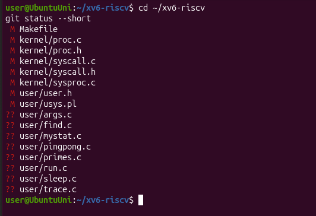

I committed everything in my xv6 tree, on the branch `lab` (commit `cac0969`, 16 files changed, 296 insertions):

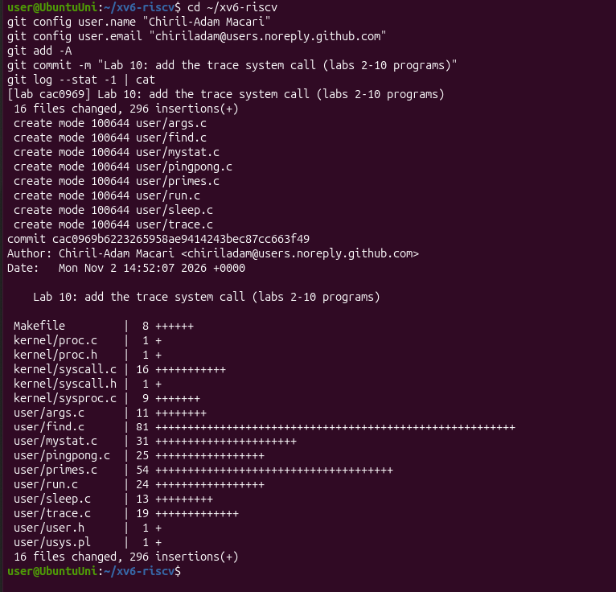

The same tree is in the folder `lab10/xv6-riscv` of my repository. The optional part (the system call `sysinfo`) is not graded and I did not do it.

## Conclusions

In this lab I added a system call to the kernel for the first time and followed the number 23 all the way: the stub `usys.S` puts 23 into register `a7` and runs `ecall`, the kernel looks the number up in the table `syscalls[]`, runs `sys_trace()`, which stores the mask in the `struct proc` of the process, and after every call the function `syscall()` checks the bit of the call number in the mask and prints a line with `printk`. Check 1 (`unknown sys call 23`) showed me the half of the way that works before the kernel part is written.

I also saw why the mask is copied in `fork()` and kept by `exec`: the same ideas as for the file descriptors in Lab 7 and 8, a child inherits the state of its parent. `trace` is what I used `strace` for in Lab 9, only now I built it myself.
