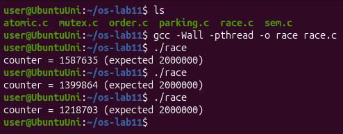
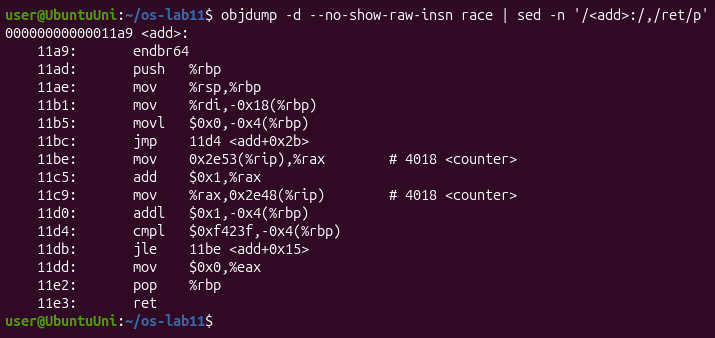
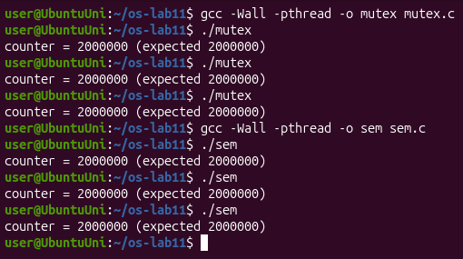
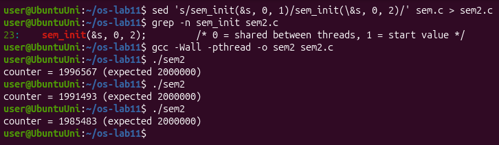
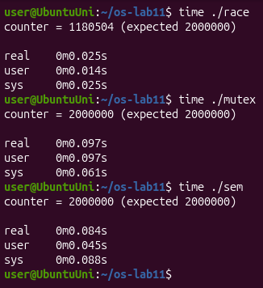
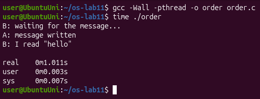
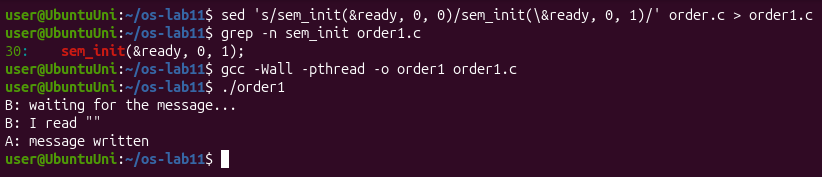
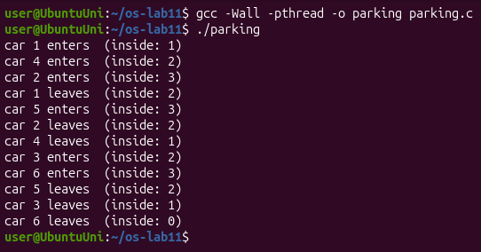
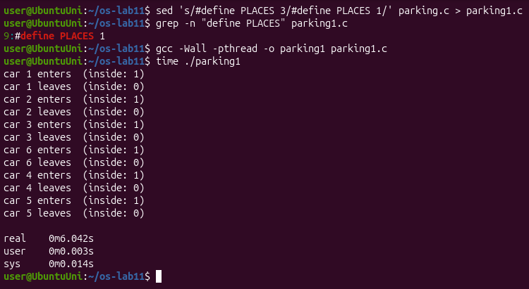
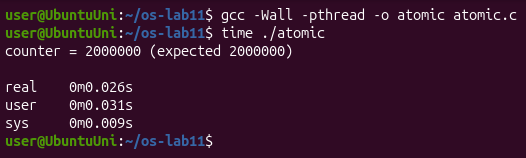

# Lab 11 – The Race and the Semaphore (Linux)

## Purpose of the work

The purpose of this lab is to see what happens when two threads change the same variable at the same time, and how to fix it. First I watched a race lose work, then I fixed it with a mutex and with a semaphore, and after that I used the same semaphore in two more ways: as a signal (one thread waits for another) and as a counter (at most three threads inside).

I worked in Ubuntu in VirtualBox (3 CPUs), in a folder `~/os-lab11`. Every program was compiled with `gcc -Wall -pthread` and without `-O2`, as the sheet says, so that `counter++` really goes to memory every time. When I needed to change a program for an experiment, I made a copy with `sed` (for example `sem2.c`, `order1.c`, `parking1.c`), so the files I hand in are the original ones.

## Part 1. See the race

`race.c` starts two threads, and each one adds 1 to the global `counter` one million times. The right answer is 2 000 000. I compiled it and ran it three times:

The results were 1 587 635, 1 399 864 and 1 218 703, so every time around 400 000 – 800 000 additions were lost, and never the same number. To see what `counter++` really is, I looked at the machine code of the function `add`:

**Observe**

**1. counter++ looks like one step. Write the three steps the CPU really does.**

In Figure 1.2 `counter++` is the three instructions at `11be`, `11c5` and `11c9`:

- load: `mov 0x2e53(%rip),%rax` copies `counter` from memory into the register `rax`;
- add: `add $0x1,%rax` adds 1, but only inside the register;
- store: `mov %rax,0x2e48(%rip)` writes the register back into `counter` in memory.

**2. Describe, with those steps, how two threads can lose one addition.**

Say `counter` is 100. Thread A loads 100 into its register. Before A stores, thread B (on the other CPU, or after a switch) also loads 100. A adds 1 and stores 101, then B adds 1 to its own 100 and also stores 101. Two additions were done, but the counter grew only by one: B wrote over the result of A. Each time this happens one addition is lost.

**3. Why is the result different at every run?**

Because the result depends on how exactly the two threads overlap, and nobody controls that: the threads run on different CPUs at the same time, the scheduler can stop a thread between any two instructions, and other processes and interrupts change the timing a little at every run. So the number of collisions is different every time, and so is the result.

## Part 2. Fix it: mutex, then semaphore

In `mutex.c` the line `counter++` is between `pthread_mutex_lock(&lock)` and `pthread_mutex_unlock(&lock)`, so it is a critical section: only one thread can be there. In `sem.c` the same thing is done with a semaphore that starts at 1: `sem_wait(&s)` takes the unit (1 → 0) and the other thread has to wait, `sem_post(&s)` gives it back. I ran each program three times:

Then I tried a semaphore that starts at 2. I made a copy `sem2.c` with `sem_init(&s, 0, 2)` and ran it three times:

At the end I measured the price of the lock with `time`:

**Observe**

**1. Run mutex and sem three times each. Is the answer always 2 000 000?**

Yes. All six runs printed `counter = 2000000 (expected 2000000)` (Figure 2.1). With the lock the three steps of `counter++` are never cut in half by the other thread, so no addition is lost.

**2. What would happen in sem.c with sem_init(&s, 0, 2)? Try it and explain.**

The result is wrong again: 1 996 567, 1 991 493 and 1 985 483 (Figure 2.2). The value of the semaphore is how many threads may be inside at the same time. With 2 both threads can pass `sem_wait` together, so there is no mutual exclusion any more and the race from Part 1 comes back. Fewer additions are lost than in `race` (between 3 433 and 14 517 instead of hundreds of thousands), because the threads spend a lot of time in `sem_wait`/`sem_post` and are inside `counter++` together less often, but the answer is still wrong.

**3. Why is the locked version slower?**

In my run `race` took 0.025 s (and was wrong), `mutex` 0.097 s and `sem` 0.084 s, so the locked versions are about 3–4 times slower. For every addition they do two more operations, lock and unlock (2 million times in total). These are atomic instructions that make the two CPUs pass the cache line with the lock between them, and when the lock is busy the thread even asks the kernel to sleep and to be woken up (the `futex` system call). The two threads also can no longer add in parallel: only one is inside at a time. In my run the semaphore was a bit faster than the mutex (the sheet has the opposite order), but the difference is small and changes from run to run; both are clearly slower than the version without a lock.

## Part 3. A semaphore as a signal

In `order.c` thread B must read the message only after thread A has written it. The semaphore `ready` starts at 0, so B stops at `sem_wait(&ready)` until A calls `sem_post(&ready)`. B is created first on purpose:

B printed its first line at once, then nothing happened for about one second (`real 0m1.011s`), and then A wrote the message and B read `"hello"`. Then I made a copy `order1.c` where the semaphore starts at 1:

**Observe**

**1. Change the start value to 1 (sem_init(&ready, 0, 1)), compile, run. What does B read now, and why?**

B reads an empty string: `B: I read ""`, and only after that A prints `A: message written` (Figure 3.2). With the value 1 the semaphore already says "ready" at the start, so `sem_wait` takes the unit and returns at once, without waiting for A. `message` is a global array, so it is still all zeros, an empty string. A writes `hello` one second later, when B has already finished reading.

**2. Put it back to 0. In one sentence: what does a semaphore that starts at 0 mean?**

A semaphore that starts at 0 means "the event has not happened yet": whoever calls `sem_wait` sleeps until another thread announces the event with `sem_post`.

## Part 4. A semaphore as a counter: the parking lot

In `parking.c` six cars (threads) want to enter a parking lot with three places. The semaphore `places` starts at 3 and counts the free places; the mutex only keeps `inside++` and its `printf` together.

Then I made a copy `parking1.c` with `#define PLACES 1` and ran it with `time`:

**Observe**

**1. What is the largest value of "inside" you see? Which line of code guarantees it?**

The largest value is 3 (Figure 4.1). In my run cars 1, 4 and 2 entered first, and car 5 entered only after car 1 left. This is guaranteed by `sem_wait(&places);` at the start of `car()`, together with `sem_init(&places, 0, PLACES)` with `PLACES` = 3: three cars take the three units, and the fourth car sleeps in `sem_wait` until one car leaves and calls `sem_post(&places)`.

**2. Set PLACES to 1. What does the semaphore become?**

It becomes a lock, the same as the semaphore of `sem.c` in Part 2 (a binary semaphore, like a mutex): only one car can be inside, `inside` is never more than 1, every car enters and leaves before the next one enters, and the whole program takes 6 seconds (`real 0m6.042s`) instead of 2, because the six cars park one after another.

## Optional: no lock at all

I also ran `atomic.c`, where `counter` is an `atomic_long` and every addition is one `atomic_fetch_add`, so load, add and store are one indivisible step:

The result is correct, 2 000 000, and it took only 0.026 s, about as fast as the wrong `race` and almost four times faster than the mutex, because there is no lock to take and release and the threads never sleep. This works only for something as simple as one counter; a whole block of code still needs a lock.

## Conclusions

In this lab I saw that `counter++` is not one step but three (load, add, store), and that two threads which run at the same time can mix those steps and lose additions, a different number at every run. A mutex or a semaphore that starts at 1 makes the line a critical section and the result is always right, but it costs time: in my runs the locked versions were 3–4 times slower.

I also saw that a semaphore is just a number that never goes below 0, and the start value decides what it is used for: 1 is a lock, 0 is a signal ("wait until it happened"), and N is a counter of free places. With the wrong start value (2 for the lock, 1 for the signal) the program compiles and runs, but gives a wrong result.
