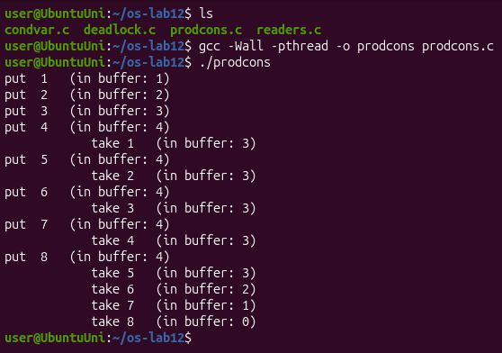
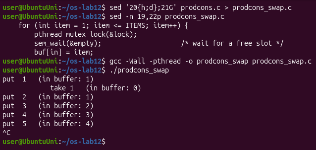
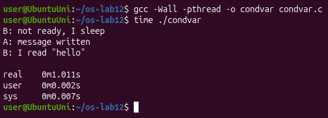
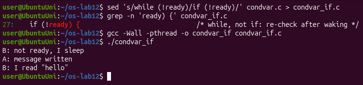
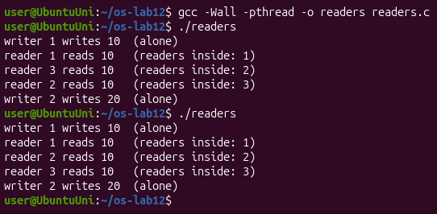
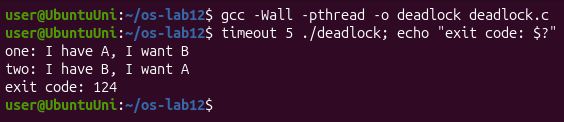
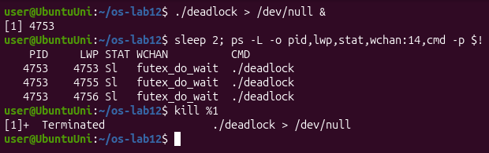
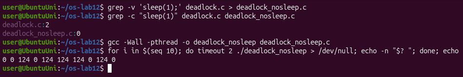
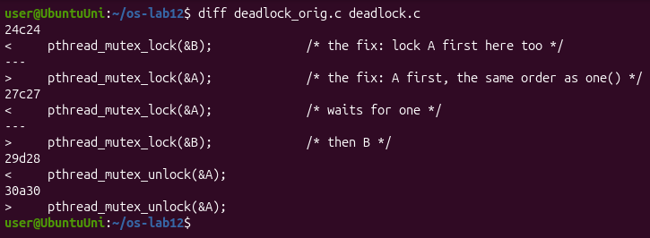
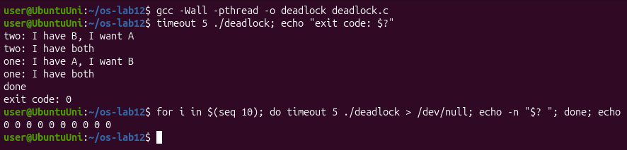

# Lab 12 – Producer, Consumer and the Other Tools (Linux)

## Purpose of the work

In Lab 11 I used one semaphore at a time. The purpose of this lab is to make the tools work together and solve the two classic problems: producer and consumer (two semaphores and a mutex around a buffer) and readers and writers. I also used a condition variable for the first time, and I built a deadlock on purpose and then removed it.

I worked in Ubuntu in VirtualBox (3 CPUs), in a folder `~/os-lab12`, and compiled every program with `gcc -Wall -pthread`. For the experiments that change a program I made copies (`prodcons_swap.c`, `condvar_if.c`, `deadlock_nosleep.c`), so the originals stay correct. The only file I changed is `deadlock.c`, which the sheet asks to hand in in its fixed version (the original is kept as `deadlock_orig.c`).

## Part 1. Producer and consumer

The producer puts the numbers 1 to 8 into a buffer of 4 slots, and a slow consumer (it sleeps 0.3 s after every item) takes them out. `empty` counts the free slots and starts at 4, `full` counts the filled slots and starts at 0, and the mutex `lock` protects the buffer and the indexes `in` and `out`.



The output is exactly the one from the sheet: the producer fills the 4 slots at once, and after that it can put a new item only after the consumer has taken one, so the two alternate until the producer is done and the consumer empties the buffer.

For question 3 I made a copy `prodcons_swap.c` in which the first two lines of the loop in `producer()` are swapped (line 20 and 21), so the mutex is locked before `sem_wait(&empty)`. I ran it and stopped it with Ctrl-C:



**Observe**

**1. The producer is fast, yet "in buffer" never goes above 4. Which call stops it?**

`sem_wait(&empty)` at the start of the loop in `producer()`. `empty` starts at 4, and every `put` takes one unit. After `put 4` the value is 0, so the producer sleeps in `sem_wait(&empty)` until the consumer takes an item and calls `sem_post(&empty)`. That is why after every `take` there is exactly one `put`.

**2. Who waits at the start: the consumer or the producer? Which call makes it wait?**

The consumer. It is created first, but the buffer is empty and `full` starts at 0, so it sleeps in `sem_wait(&full)` until the producer has put the first item and called `sem_post(&full)`. That is why the first line is `put 1` and not a `take`.

**3. In producer(), swap the first two lines: lock the mutex BEFORE sem_wait(&empty). Run it. What happens when the buffer is full, and why?**

The program gets stuck (Figure 1.2). In my run the consumer took item 1, then the producer put 2, 3, 4, 5 and the buffer was full (`in buffer: 4`), and after that nothing else was printed until I pressed Ctrl-C. The producer now takes the mutex first and then calls `sem_wait(&empty)` on a full buffer, so it goes to sleep while it holds the mutex. The consumer wakes up from its `usleep`, wants to take an item, and blocks on `pthread_mutex_lock(&lock)`. The producer waits for the consumer to free a slot, and the consumer waits for the producer to unlock the mutex: a deadlock. The rule is: never sleep on a semaphore while holding the lock that the other side needs. I did the experiment on a copy, so `prodcons.c` still has the lines in the right order.

## Part 2. The condition variable

`condvar.c` solves the problem of `order.c` from Lab 11 in another way. The state is a normal variable `ready`, protected by a mutex, and the condition variable `changed` is only the place where B sleeps until A says that something changed. `pthread_cond_wait` unlocks the mutex, sleeps, and locks it again before it returns.



B printed `not ready, I sleep`, then after one second (`real 0m1.011s`) A wrote the message and B read `"hello"`. Then I made a copy `condvar_if.c` with `if (!ready)` instead of `while (!ready)`:



**Observe**

**1. In order.c (Lab 11) the semaphore itself remembered that the message was ready. Here, which variable remembers it?**

The variable `ready` (an `int`, protected by the mutex `lock`). A condition variable has no value and remembers nothing: if A called `pthread_cond_signal` when nobody was waiting, the signal would simply be lost. That is why B first checks `ready` under the mutex and goes to sleep only if it is still 0.

**2. Replace "while (!ready)" with "if (!ready)", compile, run. Does it still work here?**

Yes, the output is the same (Figure 2.2). In this program there is only one waiter and only one signal, and A sets `ready = 1` before it signals, so when B wakes up `ready` really is 1.

**3. Then why do we write while? Give one reason why a thread can wake up and still find ready == 0.**

Because waking up does not guarantee that the condition is true. `pthread_cond_wait` may return without any signal (a spurious wakeup, which POSIX allows). Also, between the signal and the moment the woken thread takes the mutex again, another thread can take the mutex first and change the state back (for example another reader that consumes the message and sets `ready = 0`). With `while` the thread checks again after every wake-up and goes back to sleep if the condition is still false; with `if` it would continue with wrong data.

## Part 3. Readers and writers

`readers.c` has 3 readers and 2 writers. Readers may read together, but a writer must be alone. The semaphore `room` (1 = free for a writer) is taken by the first reader that comes in and given back by the last one that leaves; `rlock` protects the counter `readers`. I ran it two times:



In both runs writer 1 wrote 10 alone, then the three readers were inside together (the counter went 1, 2, 3; in the first run the order was 1, 3, 2), and writer 2 wrote 20 only after all the readers had left.

**Observe**

**1. Three readers are inside at the same time, but a writer is always alone. Which two lines of reader() make that possible?**

`if (++readers == 1) sem_wait(&room);` and `if (--readers == 0) sem_post(&room);`. Only the first reader that enters takes the room, and it takes it for the whole group, so the next readers do not wait on `room` at all. Only the last reader that leaves gives the room back. A writer calls `sem_wait(&room)` and gets in only when there is no reader inside, and while it is inside the first reader blocks on `room`.

**2. Why does the counter readers need its own lock (rlock)? What could go wrong without it?**

Because `++readers` and `--readers` are read-modify-write, exactly like `counter++` in Lab 11, and several readers change it at the same time. Without `rlock` two readers could both read 0 and both think they are the first: both would call `sem_wait(&room)` and the second would sleep forever on the room its own group holds. Or two readers that leave together could both read 2 and both write 1, so the counter never reaches 0, `sem_post(&room)` is never called, and the writers are locked out forever.

**3. Imagine readers that keep arriving without a pause. What happens to writer 2? (This problem has a name: starvation.)**

Writer 2 would wait forever. As long as at least one reader is inside, `readers` never goes down to 0 and `room` is never given back, and new readers can still enter because they do not wait on `room`. The writer is not blocked by a deadlock, the program keeps working, but it never gets its turn: it starves. This solution gives priority to the readers; to be fair, a waiting writer would have to stop new readers from coming in.

## Part 4. Build a deadlock, then remove it

In `deadlock.c` thread `one` locks A and then B, and thread `two` locks B and then A, with a `sleep(1)` between the two locks. I ran it with `timeout 5`:



To see that the threads really wait, I started it in the background and looked at its threads with `ps -L`:



All three threads (the main thread in `pthread_join` and the two workers in `pthread_mutex_lock`) are in state `S`, sleeping in `futex_do_wait` in the kernel. They use no CPU, they just wait forever, so I stopped the program with `kill`.

For question 2 I made `deadlock_nosleep.c` from the original without the two `sleep(1);` lines and ran it ten times, printing only the exit code of each run:



Then I fixed `deadlock.c`: in `two()` A is locked first and B second, the same order as in `one()`, and the unlocks are swapped too (the `printf` text stayed the same as in the sheet):





The fixed program prints `done` and exits with 0. In this run `two` got both locks first, and `one` waited for it and then got both too. In ten more runs the exit code was always 0.

**Observe**

**1. In the stuck run, which thread holds which mutex, and which one is each thread waiting for? Draw the circle.**

`one` holds A and waits for B; `two` holds B and waits for A. Each one waits for a lock that the other one holds, and neither will let go first:

```
      holds            waits for
one ---------> A <------------- two
 ^                               |
 |  waits for              holds |
 +-------------- B <-------------+
```

**2. Remove both sleep(1) lines from the ORIGINAL version and run it ten times. Does it still always hang? Why is that worse, not better?**

No. In my ten runs the exit codes were `0 0 124 0 124 124 124 0 124 0`, so it hung in 5 runs out of 10 and finished normally in the other 5 (Figure 4.3). Without the sleep, one thread can often take both locks before the other one even starts, and then there is no deadlock. This is worse, because the bug is still there but it shows up only sometimes: the program can pass the tests many times and then freeze for a user, and when you try to repeat it, it works. A bug that always shows is easy to find, a bug that depends on timing is not.

**3. In one sentence: why can taking the locks in the same order never deadlock?**

Because a circle of waiting cannot form: a thread that holds B has already got A, so nobody can hold B while waiting for A, and the thread that holds A only waits for B, which will be released.

## Conclusions

In this lab the tools worked together. In producer and consumer, two semaphores count the free and the filled slots and a mutex protects the buffer; the semaphores put the fast producer and the empty-handed consumer to sleep, and the order of the calls matters: sleeping on a semaphore while holding the mutex freezes both threads. The condition variable does the same job as the semaphore at 0 from Lab 11, but the state is in a normal variable and must be checked again with `while` after waking up.

In readers and writers, the first reader in and the last reader out decide for the whole group, which lets readers work together but can starve a writer. Finally, I saw a deadlock happen (two threads, two locks in opposite order, a circle of waiting), I saw that without the sleep it happens only half of the time, which makes it harder to find, and I removed it by taking the locks in the same order everywhere.
