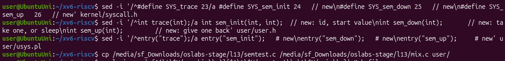
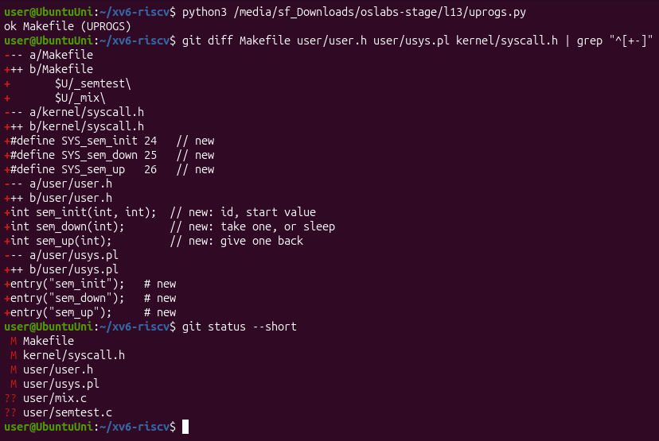
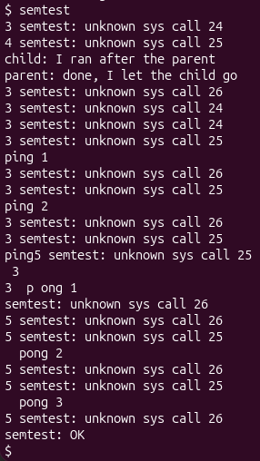
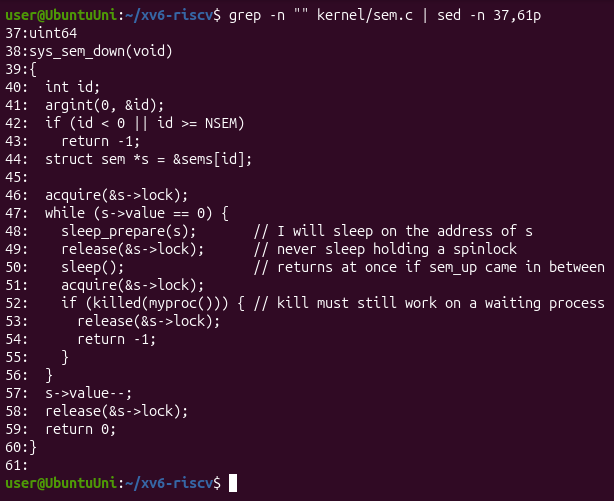
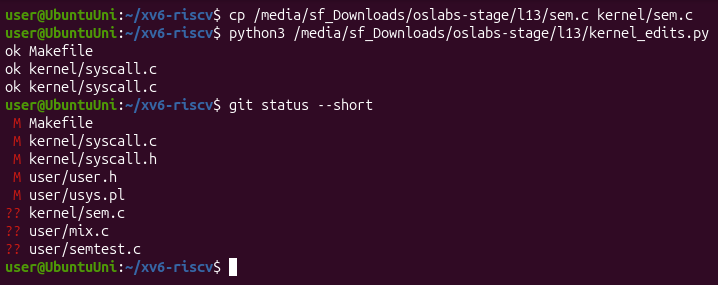
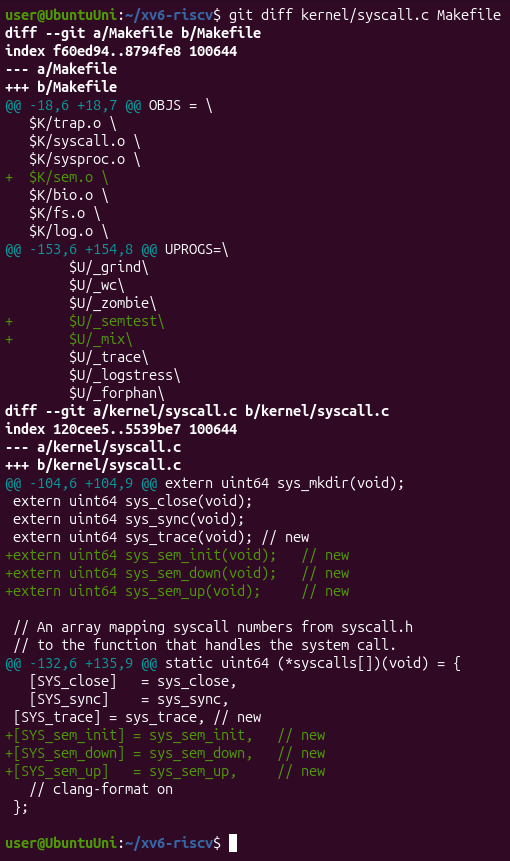
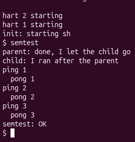
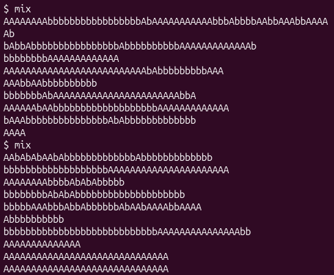
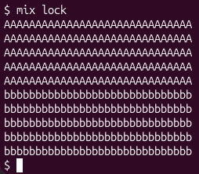
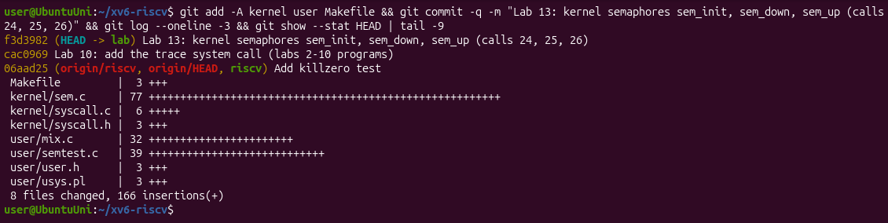

# Lab 13 – Semaphores in Your Own Kernel (xv6)

## Purpose of the work

In Labs 11 and 12 I used the semaphores of the C library. The purpose of this lab is to build them myself, inside the xv6 kernel, as three new system calls: `sem_init` (24), `sem_down` (25) and `sem_up` (26). A semaphore here is a number, a spinlock that protects it, and the `sleep`/`wakeup` of the kernel, so a process that waits really sleeps and uses no CPU.

I worked in my xv6 tree `~/xv6-riscv` in Ubuntu in VirtualBox, on the branch `lab` that already has `trace` from Lab 10 (call 23, commit `cac0969`), so the new calls go right after it with the numbers from the sheet. I started xv6 with `make qemu`, which uses 3 CPUs (`-smp 3`).

## Part 1. The numbers and the user side

The user side is the same recipe as `trace` in Lab 10, three times:

- `kernel/syscall.h`: `#define SYS_sem_init 24`, `SYS_sem_down 25` and `SYS_sem_up 26`, after `SYS_trace 23`;
- `user/user.h`: the declarations `int sem_init(int, int);`, `int sem_down(int);`, `int sem_up(int);`;
- `user/usys.pl`: `entry("sem_init");`, `entry("sem_down");`, `entry("sem_up");`, so at build time `usys.S` gets three stubs that put 24, 25 and 26 into register `a7` and call `ecall`;
- `user/semtest.c` and `user/mix.c`: the two test programs from the sheet;
- `Makefile`: `$U/_semtest\` and `$U/_mix\` in `UPROGS`, after `$U/_zombie\` (with a TAB).

I added the lines with `sed -i` (each new line goes right after the existing line for `trace`) and copied the two programs from my shared folder:

For the `Makefile` I used a small Python script, `uprogs.py`, because the lines there start with a TAB and end with a backslash and it is easy to break them with `sed`. The script stops with an error if it does not find the `_zombie` line. Then I checked all the changes with `git diff` and `git status`:

**Check 1.** I started xv6 with `make qemu` and ran `semtest`. The kernel does not know the calls 24, 25 and 26 yet, so it has to complain:

The first lines are exactly the ones from the sheet: `3 semtest: unknown sys call 24` (the parent, pid 3, calls `sem_init`) and `4 semtest: unknown sys call 25` (the child, pid 4, calls `sem_down`). The message comes from the `else` branch of `syscall()`, so my program really ran `ecall` with `a7` = 24 and 25 and the kernel received it. The important line is the order: `child: I ran after the parent` comes BEFORE `parent: done, I let the child go`, because `sem_down` did nothing and the child did not wait. After that ping and pong and the error lines are all mixed (there is even `ping5 semtest...` where two processes wrote into the same line).

## Part 2. The kernel side

The kernel side is a new file, `kernel/sem.c`, with a table of 8 semaphores shared by all processes. Every semaphore is a `struct sem` with a spinlock and a value. `sys_sem_init` sets the value, `sys_sem_up` adds 1 and calls `wakeup(s)`, and `sys_sem_down` is the important one:

While the value is 0, the process registers the address of `s` as the thing it waits for (`sleep_prepare(s)`), releases the spinlock and sleeps. Our kernel sleeps in two steps: `sleep()` checks if a `wakeup` on that address came after `sleep_prepare`, and in that case it returns at once, so a `sem_up` that comes between `release` and `sleep()` is not lost. After waking up it takes the lock again and checks the value again. Then it takes one unit with `s->value--`.

I copied `sem.c` into `kernel/`, and made the other two edits with a Python script, `kernel_edits.py` (the same idea as in Lab 10: it stops with an error if a place is not found, so nothing is applied half):

- `Makefile`: `$K/sem.o \` in `OBJS`, after `$K/sysproc.o \`, so `sem.c` is compiled into the kernel;
- `kernel/syscall.c`: the three `extern uint64 sys_sem_...(void);` declarations and the entries `[SYS_sem_init] = sys_sem_init` and so on in the table `syscalls[]`, so that `syscall()` calls my functions for 24, 25 and 26.

**Check 2.** I left xv6 with Ctrl-A X, started it again with `make qemu` (it rebuilt the kernel with `sem.o`) and ran `semtest`:

Now the output is exactly the one from the sheet. The parent waits 10 ticks with `pause(10)` before `sem_up(0)`, and still the child prints second, because it was asleep in `sem_down(0)` on a semaphore that started at 0. Ping and pong alternate strictly three times: semaphore 1 (starts at 1) is the turn of ping and semaphore 2 (starts at 0) is the turn of pong, and each one gives the turn to the other with `sem_up`.

## Part 3. A semaphore as a lock: mix

`mix` starts two processes, and each one prints five lines, one letter per `write()`. I ran it two times without the lock:

and then with the lock (`mix lock`, semaphore 3 started at 1):

Without the lock both runs are mixed, and differently each time; with the lock all ten lines are whole, first the five lines of the parent, then the five lines of the child.

**Observe**

**1. Without the lock, why do the letters mix? (How many system calls does one line cost?)**

Because one line is not printed at once. `mix` writes one letter per `write()`, so one line costs 31 system calls (30 letters and the `\n`). `make qemu` starts xv6 with 3 CPUs (`-smp 3`), so the parent and the child really run at the same time, and between any two `write()` calls of one process the other process can do its own `write()`. The console only sees a stream of single letters from two processes, so they come out mixed, and the lines even have different lengths (Figure 3.1). Every run is mixed differently, because it depends on the timing.

**2. With the lock every line is whole. Which two lines of mix.c make one line a critical section?**

`if (uselock) sem_down(3);` before the inner `for` loop, and `if (uselock) sem_up(3);` after it. Semaphore 3 starts at 1 (`sem_init(3, 1)`), so it is a lock: the process that gets past `sem_down(3)` writes its 31 letters, and the other one sleeps in `sem_down(3)` until `sem_up(3)`. That is why every line is whole (Figure 3.2).

**3. In sem_down the test is "while (s->value == 0)", not "if". Why can a process wake up and still find 0?**

Because `sem_up` adds only 1 but `wakeup(s)` wakes up every process that sleeps on `s` (in `kernel/proc.c` `wakeup` goes through the whole process table and makes every process with `p->chan == chan` runnable). Only the first one that gets `s->lock` takes the unit; the others get the lock after it and find `value` 0 again, so they must go back to sleep. Also, a process that was not sleeping at all can call `sem_down` between the `sem_up` and the moment the woken process takes the lock, and take the unit first. With `if`, the woken process would do `s->value--` on 0 and the value would become -1, so two processes would be inside a lock that allows one.

**4. sem_down calls release(&s->lock) BEFORE sleep(). What would go wrong if it slept holding the spinlock?**

The process that has to wake it up could never do it: `sem_up` starts with `acquire(&s->lock)`, and a spinlock does not sleep, it spins in a loop until the lock is free. The lock would be held by the sleeping process, so `sem_up` would spin forever on its CPU (with interrupts off) and never reach `s->value++` and `wakeup(s)`, and the sleeper would never wake up: a deadlock, with a CPU burning in a loop. In this xv6 it does not even get that far: `sched()` in `kernel/proc.c` (line 488) checks `if (mycpu()->noff != 1) panic("sched locks");`, so a process that tries to sleep while holding any spinlock other than its own `p->lock` makes the kernel panic.

The same answers are in the file `notes.txt`.

## Hand-in: the modified tree in git

I committed the modified tree on the branch `lab` (commit `f3d3982`, 8 files changed, 166 insertions: `kernel/sem.c`, `kernel/syscall.c`, `kernel/syscall.h`, `user/user.h`, `user/usys.pl`, `user/semtest.c`, `user/mix.c` and the `Makefile`):

The same tree is in the folder `lab13/xv6-riscv` of my repository, together with the two scripts `uprogs.py` and `kernel_edits.py`. The optional part (`sem_trydown`) is not graded and I did not do it.

## Conclusions

In this lab I built semaphores inside my own kernel as three system calls, and I saw that a semaphore is really small: a number, a spinlock that protects it, and the kernel's `sleep` and `wakeup`. Check 1 showed the calls reaching the kernel before it knew them, and the child running too early; after Part 2 the same `semtest` gave the right order and a strict ping-pong.

With `mix` I saw the same race as in Lab 11, but between processes on 3 CPUs, and fixed it with a semaphore used as a lock. The two most important details in `sem_down` are the ones from the Observe questions: the value must be checked again with `while` after waking up, because `wakeup` wakes everyone, and the spinlock must be released before sleeping, otherwise `sem_up` could never get it (and xv6 panics with `sched locks`).
