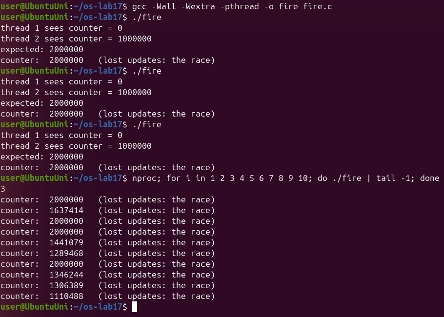
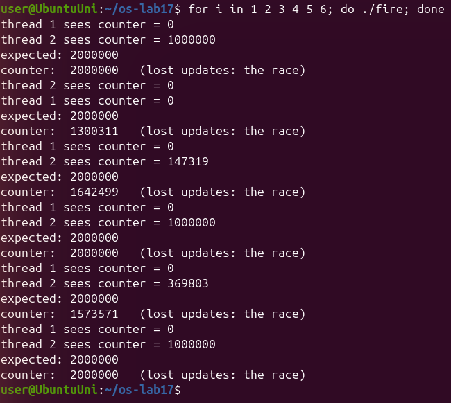
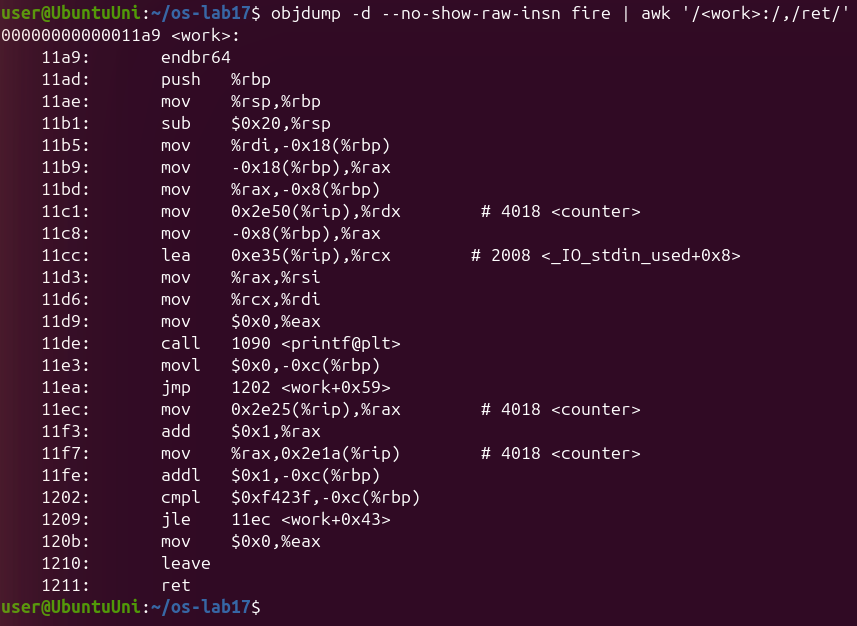
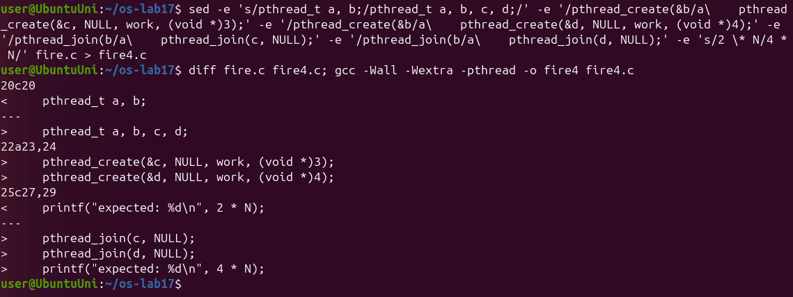
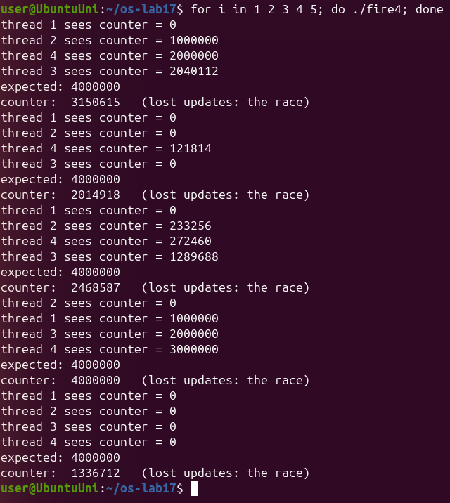
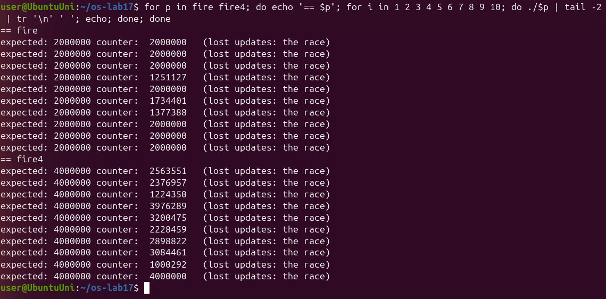

# Lab 17 – Threads Share Memory, and Race (Linux)

## Purpose of the work

The lecture said that threads share memory, which is their power and their danger. The purpose of this lab is to see both sides: two threads of one process see the same variable at once, and when both change it without any protection, some updates are lost. In Part 2 I made the race worse with four threads and proposed, on paper, how to make `counter++` safe.

I worked in Ubuntu 26.04 in VirtualBox (3 CPUs, `nproc` prints `3`), in a folder `~/os-lab17`, and compiled with the sheet's flags `gcc -Wall -Wextra -pthread`, without `-O2`. `fire.c` is exactly the program from the sheet. For Part 2 I made a copy `fire4.c` with `sed`, so `fire.c` stays the original.

## Part 1. Shared and racing

`fire.c` starts two threads, and each one does `counter++` one million times on the same global variable `counter`, with no lock. Before its loop, each thread prints the value of `counter` it sees. I compiled it (no warnings) and ran it three times, as the sheet says, and then ten more times in a loop, printing only the last line:



The first three runs gave the right answer, `2000000`, and in all three `thread 2 sees counter = 1000000`. That means thread 1 had already finished all its one million additions before thread 2 even started: the two loops did not overlap, so there was nothing to race. The loop is very short, and in my VM starting the second thread sometimes took longer than the whole loop of the first one. In the next ten runs the threads did overlap 6 times out of 10, and those runs lost updates: `1637414`, `1441079`, `1289468`, `1346244`, `1306389` and `1110488`, never the same number. In the worst one, `1110488`, almost 900 000 additions were lost.

To see the start of each run as well, I ran `fire` six more times with the full output:



Runs 3 and 5 look exactly like the sheet: thread 2 started while thread 1 was in the middle of its loop (`thread 2 sees counter = 147319` and `369803`), and the results were `1642499` and `1573571`. In run 2 thread 2 even printed first, and both saw `0`, so they started together, and the result was `1300311`. In runs 1, 4 and 6 thread 2 saw `1000000` again, the loops did not overlap, and the result was right.

To see what `counter++` is for the CPU, I disassembled the function `work` with `objdump`:



**Observe**

**1. Thread 2 prints a non-zero counter at the start. What does that prove about the memory of the two threads?**

It proves that the two threads use the same memory: there is only one `counter`, at one address (`4018 <counter>` in Figure 1.3), and both threads read and write it. Thread 2 did not touch `counter` before its `printf`, and still it saw `147319`, `369803` or `1000000` (Figure 1.2), which are the additions that thread 1 had already made. If every thread had its own copy of the global variables, like a child after `fork()` in Lab 7, thread 2 would always print `0`. Threads of one process share the whole address space (globals, heap, code); only the stack and the registers are their own.

**2. Why is the final counter less than 2000000, and different each run? Explain with the three steps of counter++.**

`counter++` is not one step. In Figure 1.3 it is three instructions:

- read: `11ec: mov 0x2e25(%rip),%rax` copies `counter` from memory into the register `rax`;
- add: `11f3: add $0x1,%rax` adds 1 in the register;
- write: `11f7: mov %rax,0x2e1a(%rip)` writes the register back into `counter`.

Each thread has its own `rax`, but `counter` is shared. Say `counter` is 500. Thread 1 reads 500 into its `rax`. Before it writes, thread 2, on another CPU, also reads 500. Thread 1 adds 1 and writes 501, then thread 2 adds 1 to its own 500 and also writes 501. Two additions were done, but the counter grew by one: thread 2 wrote over the result of thread 1. Every such collision loses one update, so the final value is less than 2 000 000.

The number is different every run because the number of collisions depends on the timing: when the second thread starts (Figure 1.2 shows it starting at `0`, `147319`, `369803` or after thread 1 has finished), on which CPU each thread runs, and when the scheduler or an interrupt stops a thread between the read and the write. Nobody controls that, so every run loses a different amount, and when the two loops do not overlap at all, nothing is lost.

## Part 2. Make it worse, then think

I made a copy `fire4.c` with two more threads (`c` and `d`, with ids 3 and 4), joined them, and changed the expected value to `4 * N`. I did it with `sed` and checked the change with `diff`:

```
sed -e 's/pthread_t a, b;/pthread_t a, b, c, d;/' \
    -e '/pthread_create(&b/a\    pthread_create(&c, NULL, work, (void *)3);' \
    -e '/pthread_create(&b/a\    pthread_create(&d, NULL, work, (void *)4);' \
    -e '/pthread_join(b/a\    pthread_join(c, NULL);' \
    -e '/pthread_join(b/a\    pthread_join(d, NULL);' \
    -e 's/2 \* N/4 * N/' fire.c > fire4.c
```



Then I ran it five times with the full output:



Now the expected value is `4000000`, and four of the five runs lost updates: `3150615`, `2014918`, `2468587` and `1336712`. Only run 4 was right, and there the four threads ran one after another (they saw `0`, `1000000`, `2000000`, `3000000`). In run 5 all four threads saw `0`, so all four loops started together, and the result was only `1336712`: about two thirds of the additions were lost.

To compare two and four threads in the same conditions, I ran each program ten times, one after the other:



Yes, the loss gets bigger. With two threads only 3 of 10 runs lost updates (`1251127`, `1734401`, `1377388`), and on average the result was 1 836 292 out of 2 000 000, so about 8 % was lost. With four threads 9 of 10 runs lost updates, the average was 2 655 366 out of 4 000 000, so about 34 % was lost, and the worst run, `1000292`, lost three quarters of the additions. With more threads, more loops run at the same time on my 3 CPUs, so there are more chances that two threads are between the read and the write of the same `counter` at the same moment. The numbers jump a lot from run to run (Figure 1.1 had 6 of 10 runs lose with two threads), but in both experiments four threads lost much more.

**My proposal (on paper).** The three steps must become one step that no other thread can cut: only one thread at a time may be between the read and the write. The simplest way is a lock around the line:

```
pthread_mutex_t lock = PTHREAD_MUTEX_INITIALIZER;
...
for (int i = 0; i < N; i++) {
    pthread_mutex_lock(&lock);      /* only one thread gets past here */
    counter++;                      /* read, add, write: never mixed now */
    pthread_mutex_unlock(&lock);
}
```

A thread that calls `pthread_mutex_lock` while another thread holds the lock waits, so the read, add and write of two threads can never mix, and the result is always 2 000 000 (or 4 000 000). I did not build it here, because the sheet says this is built next week.

**Observe**

**3. In one sentence: what single idea would stop the lost updates? (You build it next week.)**

Mutual exclusion: make `counter++` a critical section, protected by a lock, so that only one thread at a time can do its read, add and write on `counter`.

## Conclusions

In this lab I saw both sides of threads. They share memory: thread 2 saw the additions of thread 1 right away (`147319`, `369803`, `1000000`), because there is only one `counter` in the process. And they race: `counter++` is three instructions (read, add, write), and when two threads mix them, additions are lost, a different number at every run (`1642499`, `1573571`, `1300311` …). In my VM the race did not show in every run, because sometimes the second thread started only after the first one had finished; in every run of Figure 1.2 where thread 2 started during the loop of thread 1, updates were lost.

With four threads the loss was much bigger: 9 of 10 runs were wrong and up to three quarters of the additions were lost, against 3 of 10 runs with two threads. The fix is the idea from Lab 11 and from the next lab: mutual exclusion, a lock around `counter++`, so the three steps of one thread are never cut by another.
