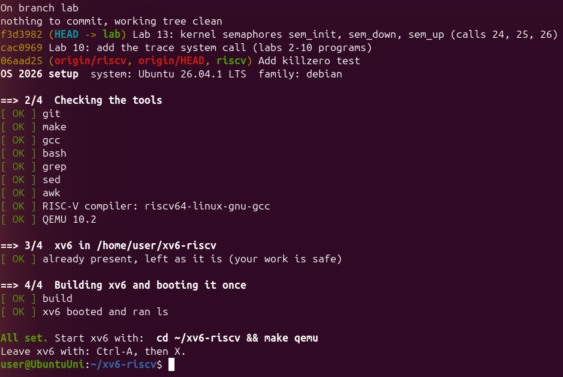
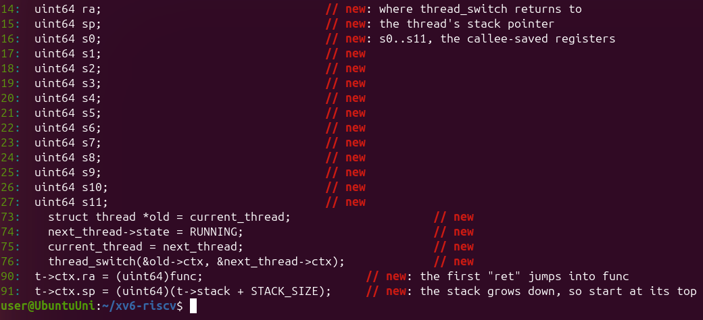
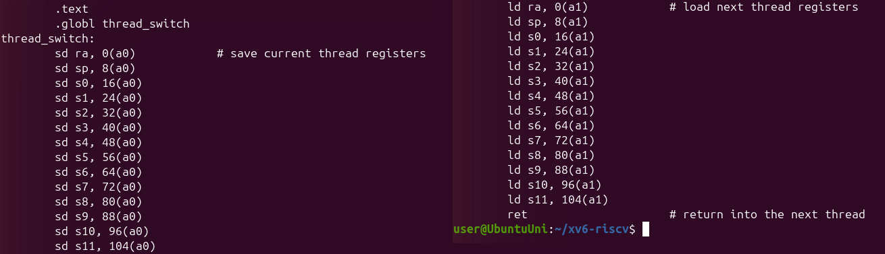
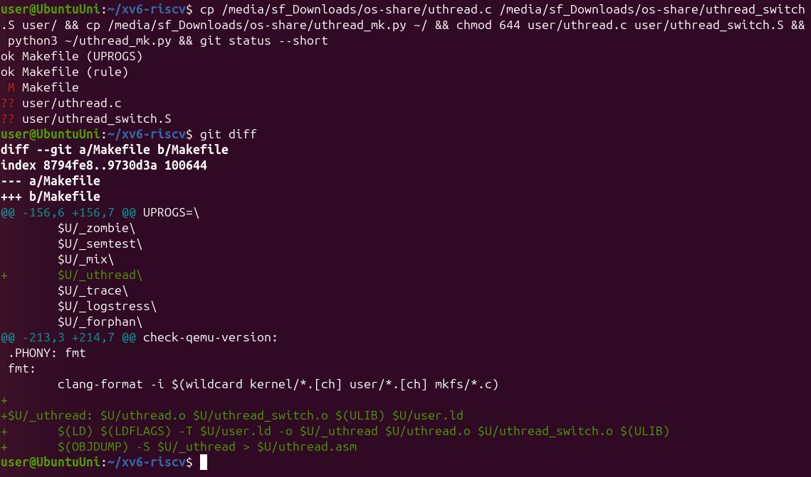
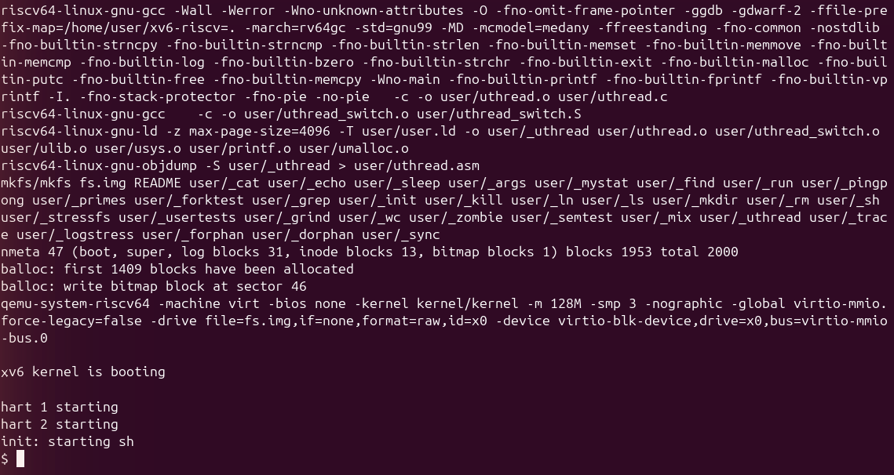
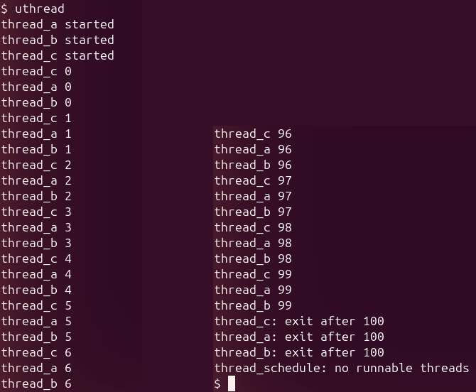
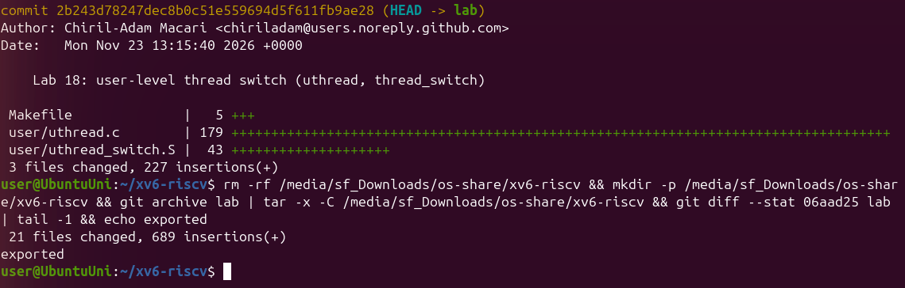

# Lab 18 – Build a User-Level Thread Switch (xv6)

## Purpose of the work

The purpose of this lab is to build a tiny thread library in user space: create threads and switch between them by saving and restoring registers, exactly like the kernel `swtch`, but entirely in my own code, with no kernel changes. In Lab 17 the threads were made by Linux; here one xv6 process runs three threads, and the threads themselves decide when to give the CPU to the next one (`thread_yield`).

I worked in my xv6 tree `~/xv6-riscv` in Ubuntu in VirtualBox, on the branch `lab`, which already has everything up to Lab 13 (commit `f3d3982`). Before starting I checked that the tree is clean and on `lab`, and ran `bash os2026-setup.sh --check`, as the sheet asks:

Every check is `OK`, including the RISC-V compiler `riscv64-linux-gnu-gcc` and QEMU 10.2, and xv6 was built and booted once. I wrote the new files on Windows and copied them into the VM through the shared folder. I started xv6 with `make qemu`, which uses 3 CPUs (`-smp 3`); the threads of this lab still run on one CPU, because the whole library lives inside one process.

## Part 1. The switch

**1.1 user/uthread.c.** I created it from the skeleton of the sheet and filled the three TODO places. The lines I added are marked with `// new`:

- `struct context` (lines 14–27): the 14 fields `ra`, `sp`, `s0` … `s11`, each a `uint64`, in this order, so `ra` is at offset 0, `sp` at 8 and `s11` at 104, the same offsets that `thread_switch` uses.
- `thread_schedule` (lines 73–76): I remember the old thread in `old`, mark `next_thread` as `RUNNING`, make it `current_thread`, and call `thread_switch(&old->ctx, &next_thread->ctx)`. `current_thread` must change before the call, because when this thread is switched back in, the code goes on right after the call.
- `thread_create` (lines 90–91): `t->ctx.ra = (uint64)func`, so the first `ret` of `thread_switch` jumps into the thread's function, and `t->ctx.sp = (uint64)(t->stack + STACK_SIZE)`, the top of the thread's own stack, because on RISC-V the stack grows down. This is the trap from the sheet: with `ra` and `sp` left at 0, the first switch would jump to address 0 with no stack.

`thread_b` and `thread_c` are copies of `thread_a`, with `a` changed to `b` (and `c`); `thread_b` waits for `a_started` and `c_started`, and `thread_c` waits for `a_started` and `b_started`, as the comment in the skeleton says.

**1.2 user/uthread_switch.S.** The sheet only gives the shape, so I wrote the whole function like `kernel/swtch.S`: 14 `sd` that save `ra`, `sp`, `s0` … `s11` into the old context (`a0`), 14 `ld` that load them from the new context (`a1`), and `ret`. I only added `.text`, `.globl thread_switch` (so `uthread.c` can call it) and a header comment.

**1.3 Makefile.** The lines of `UPROGS` start with a TAB and end with a backslash, so, as in Lab 13, I made the edit with a small Python script, `uthread_mk.py`. It puts `$U/_uthread\` in `UPROGS` after `$U/_mix\` and adds the rule from the sheet at the end of the file. It stops with an error if the `_mix` line is not found, and prints `already …` if a change is already there. Then I checked the result with `git diff`:

The special rule is needed because the normal rule `_%: %.o $(ULIB)` links only one object file, and `_uthread` needs two: `uthread.o` and `uthread_switch.o`.

## Part 2. Run it

I started xv6 with `make qemu`. It compiled `uthread.c` with the normal xv6 flags (`-Wall -Werror`, no warnings), assembled `uthread_switch.S`, linked `_uthread` with the new rule, and put it on the disk:

Then at the xv6 `$` prompt I typed `uthread`:

The output is exactly the one from the sheet (Figure 2.2). The three threads start, then they take turns in the order `c`, `a`, `b`, each one prints a number and calls `thread_yield`, and they count from 0 to 99. At the end each thread prints `exit after 100`, again in the order `c`, `a`, `b`, and the last line is `thread_schedule: no runnable threads`.

The order comes from the round robin in `thread_schedule`. `main` is thread 0; it creates `a`, `b` and `c` in slots 1, 2 and 3, marks itself `FREE` and switches to `a`. `a` prints `thread_a started`, sees that `b` and `c` have not started, and yields to `b`; `b` does the same and yields to `c`. When `c` starts, both other flags are already 1, so `c` goes straight into its loop and prints `thread_c 0` first. Then the next thread after slot 3 is slot 1, so `a`, then `b`, then `c` again. In the same way `c` is the first to finish its 100 numbers. When it finishes, it marks itself `FREE` and calls `thread_schedule`; after `a` and `b` do the same, no thread is `RUNNABLE`, and `thread_schedule` prints the last line and calls `exit(-1)`. `main` is never switched back in, so its `exit(0)` is never reached.

With `uthread` running, I left xv6 with Ctrl-A X and committed the work on the branch `lab`, as the sheet asks for the hand-in (commit `2b243d7`, 3 files changed, 227 insertions: the `Makefile`, `user/uthread.c` and `user/uthread_switch.S`). Then I exported the whole tree from that commit with `git archive lab`, so it has no `.git` and no build output:

The tree is in the folder `lab18/xv6-riscv` of my repository, together with the script `uthread_mk.py`. Compared with upstream `06aad25` it now has 21 files changed and 689 insertions (all my work from Lab 2 to Lab 18). The sheet has no optional part.

**Observe**

**1. What exactly does thread_switch save and load? Why is ra the register that makes execution continue in the other thread?**

`thread_switch` saves exactly 14 registers of the current thread into the old `struct context` (its address is in `a0`): `ra` at offset 0, `sp` at 8 and the callee-saved registers `s0` … `s11` at 16 … 104, 112 bytes in all. Then it loads the same 14 registers of the next thread from the new context (in `a1`) (Figure 1.3). It saves nothing else: not `pc`, not `a0`–`a7`, not `t0`–`t6`. `thread_switch` is called like a normal C function, and by the RISC-V calling convention the caller already expects `a*` and `t*` to be destroyed by any call (the compiler saves them itself if it still needs them), while `ra`, `sp` and `s0`–`s11` must look unchanged after the call. So these 14 registers are the whole state of a thread at the moment it calls `thread_switch`; everything else (its local variables, its chain of calls) is on its own stack, and `sp` points to it.

`ra` makes execution continue in the other thread because the last instruction is `ret`, which is `jalr x0, 0(ra)`: a jump to the address in `ra`. After the loads, `ra` is no longer the return address of the thread that called `thread_switch`, but the saved `ra` of the next thread. So `ret` "returns" into the next thread: for a thread that already ran, to the instruction right after its own call of `thread_switch` in `thread_schedule` (it then returns from `thread_yield` and goes on in its loop); for a new thread, to the first instruction of its function, because `thread_create` set `ctx.ra = func`. The new `sp` makes it continue on its own stack, with its own local variables and return addresses. The same answer is in the file `notes.txt`.

## Conclusions

In this lab I built threads without any help from the kernel. A thread is only a saved context (14 registers) and its own stack of 8 192 bytes, and a switch is 14 stores, 14 loads and a `ret`. The output was exactly the one from the sheet: three threads that take turns in the order `c`, `a`, `b` up to 99, and `thread_schedule: no runnable threads` at the end.

The most important detail is `ra`: the switch works because `ret` jumps to whatever address is in `ra`, so loading another thread's `ra` and `sp` is the whole trick, and a new thread starts because `thread_create` puts the function's address in `ra` and the top of its stack in `sp`. Compared with Lab 17 these threads never race on a variable, because only one of them runs at a time and they switch only when they call `thread_yield`. The kernel does the same switch between processes: its `swtch` saves and loads the same 14 registers.
