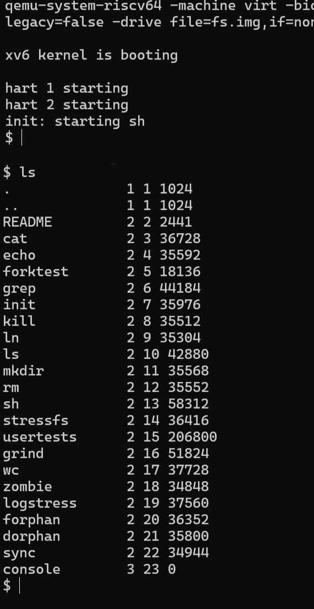
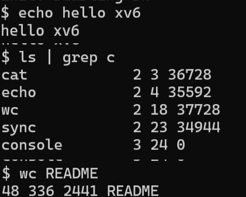
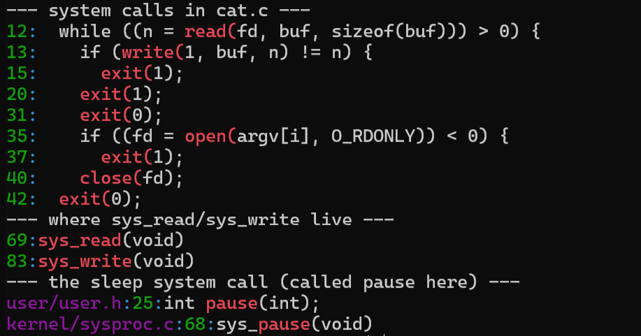
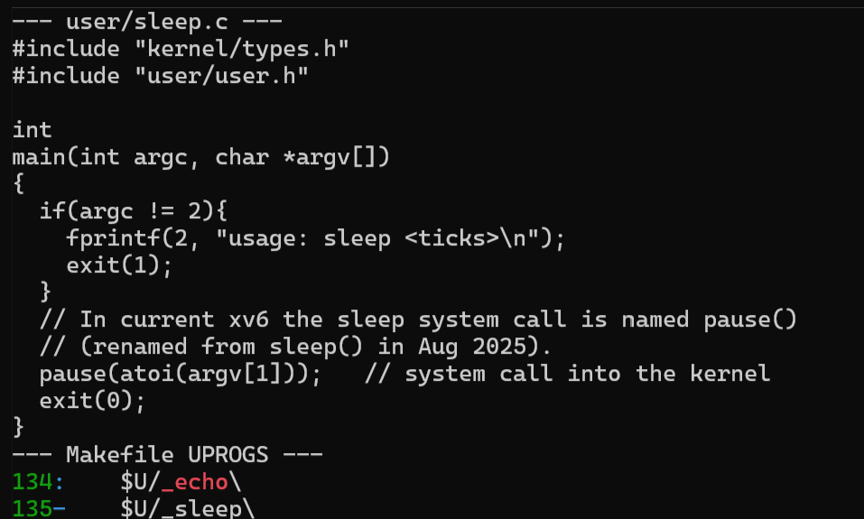
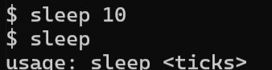

# Operating Systems Labs

Macari Chiril-Adam, FAF-243

---

# Lab 2 - Meet the OS You Will Build (xv6)

## Setup

I used the same Ubuntu in WSL 2 as in Lab 1. My Ubuntu version is pretty new, so I had two problems that are not in the lab sheet:

1. The RISC-V emulator is not in `qemu-system-misc` anymore on this Ubuntu, so `make qemu` said `qemu-system-riscv64: No such file or directory`. I fixed it with `sudo apt install qemu-system-riscv`. The version I got is QEMU 10.2.1 (xv6 needs at least 7.2).
2. I cloned the newest xv6 from `github.com/mit-pdos/xv6-riscv`, and there the `sleep()` system call is called `pause()` now (and `sys_sleep` is `sys_pause`). They renamed it so it doesn't get confused with the `sleep()` function inside the kernel. Because of that, the code from the lab sheet gave `implicit declaration of function 'sleep'`, so in my `sleep.c` I call `pause()` instead. It is the same system call, so the program works like the lab asks.

---

## Part 1 - Build it and boot it

`make qemu` compiled the kernel and the user programs with the RISC-V compiler (`riscv64-linux-gnu-gcc`), made the file system image `fs.img` and started QEMU:

```
xv6 kernel is booting

hart 1 starting
hart 2 starting
init: starting sh
$
```

"hart" means a CPU core in RISC-V. QEMU runs 3 cores (`-smp 3`). Core 0 sets up the kernel while cores 1 and 2 wait, and then they print `hart N starting` and start working too. After that the kernel starts `init` (the first process, like systemd in Lab 1) and `init` starts the shell `sh`.

---

## Part 2 - Use xv6 as the Unix it is




```
$ echo hello xv6
hello xv6
$ ls | grep c
cat            2 3 36728
echo           2 4 35592
wc             2 18 37728
sync           2 23 34944
console        3 24 0
$ wc README
48 336 2441 README
```

**1. List three programs xv6 ships with.**

`ls`, `cat` and `echo`. From the `ls` list there are also `grep`, `wc`, `sh`, `mkdir`, `rm`, `kill`, `ln` and `usertests`.

**2. Which two OS features must exist for a pipe to work?**

- Processes: the shell has to create two processes that run at the same time, one for `ls` and one for `grep`. It does that with `fork()` and then `exec()` in each child.
- Communication between processes: the kernel makes a pipe with the `pipe()` system call. It is a buffer inside the kernel with a write end and a read end. The shell connects the output of `ls` (fd 1) to the write end and the input of `grep` (fd 0) to the read end with `close()` and `dup()`. `ls` and `grep` don't know about each other, they just write and read normal file descriptors and the kernel moves the data.

I checked this in the xv6 shell code (`user/sh.c`, `case PIPE`): it calls `pipe(p)`, then `fork1()` two times, each child does `close(1); dup(p[1]);` or `close(0); dup(p[0]);`, and at the end the parent does `wait(0)` two times.

**3. In one sentence: how does the xv6 shell compare to the Linux shell from Lab 1?**

It works the same way at the base (a prompt, running programs with arguments, pipes `|`, redirection `<` `>` and `&` for background), but it's very minimal: there is no command history, no tab completion, no variables or `$PATH`, no colors, and the prompt is just `$`.

**Other things I noticed:**
- In xv6, `ls` prints `name type inode size`. Type 1 is a directory, 2 is a file and 3 is a device. `console` has type 3, so the terminal is also a file here, the same "everything is a file" idea from Lab 1.
- `ls | grep c` also showed `sync` and `console`, because `grep` looks for the letter `c` anywhere in the line.
- `wc README` gave 48 lines, 336 words and 2441 bytes.

---

## Part 3 - Read the source



```
--- system calls in cat.c ---
12:  while ((n = read(fd, buf, sizeof(buf))) > 0) {
13:    if (write(1, buf, n) != n) {
35:    if ((fd = open(argv[i], O_RDONLY)) < 0) {
40:    close(fd);
42:  exit(0);
--- where sys_read/sys_write live ---
69:sys_read(void)
83:sys_write(void)
--- the sleep system call (called pause here) ---
user/user.h:25:int pause(int);
kernel/sysproc.c:68:sys_pause(void)
```

**1. Which system calls does user/cat.c use, and what does each one ask the kernel to do?**

- `open(path, O_RDONLY)` asks the kernel to find the file, check that it can be read, and give back a file descriptor (a small number) for it.
- `read(fd, buf, n)` asks the kernel to copy up to `n` bytes from the file into `buf`. It returns 0 when the file ends.
- `write(1, buf, n)` asks the kernel to write `n` bytes from `buf` to file descriptor 1, which is the standard output (the console).
- `close(fd)` tells the kernel to free the file descriptor because the program is done with the file.
- `exit(status)` ends the process and gives the status back to the parent (the shell).

`fprintf(2, ...)` is not a system call itself, it's a library function that formats the text and then calls `write()` on fd 2 (stderr).

**2. In which kernel file, and on which line, is sys_read implemented?**

In `kernel/sysfile.c`, line 69 (and `sys_write` is on line 83). `sys_read` takes the arguments that the program sent (with `argfd`, `argaddr`, `argint`), checks that the file descriptor is valid, and then calls `fileread()`, which does the actual reading.

**3. In one sentence: what is the difference between the code in kernel/ and the code in user/?**

The code in `kernel/` is the operating system itself, it runs in privileged (supervisor) mode and can access the hardware and all the memory, while the code in `user/` is normal programs that run in user mode and can only do things like reading files or printing by asking the kernel through system calls.

**How the call gets from user/ to kernel/:** `user/usys.pl` generates a small assembly function for every system call. For example `read` becomes `li a7, SYS_read` and then `ecall`. `ecall` is the RISC-V instruction that switches the CPU into the kernel, and the kernel checks register `a7` to know which system call it is (`kernel/syscall.c`) and calls `sys_read`.

---

## Part 4 - My first xv6 program: sleep



`user/sleep.c`:
```c
#include "kernel/types.h"
#include "user/user.h"

int
main(int argc, char *argv[])
{
  if(argc != 2){
    fprintf(2, "usage: sleep <ticks>\n");
    exit(1);
  }
  // In current xv6 the sleep system call is named pause()
  // (renamed from sleep() in Aug 2025).
  pause(atoi(argv[1]));   // system call into the kernel
  exit(0);
}
```

In the `Makefile` I added `$U/_sleep\` to `UPROGS`, right after `$U/_echo\` (line 135, with a tab). This way `make` compiles `sleep.c` and puts the program in `fs.img`, the file system xv6 boots with.

Testing it in xv6:



```
$ sleep 10
$ sleep
usage: sleep <ticks>
```

`sleep 10` waited about one second and then the prompt came back. `sleep` without an argument printed my usage message and exited with 1.

10 ticks is about 1 second because a tick is one timer interrupt, and in `kernel/trap.c` the next interrupt is set to `time + 1000000`, which the comment says is about a tenth of a second in QEMU.

In the kernel, `sys_pause` (`kernel/sysproc.c`, line 68) takes the number, saves the current `ticks` value and puts the process to sleep until `ticks` goes up by that number. While my process sleeps, the scheduler runs other processes, so it doesn't use the CPU. It's the same `S (sleeping)` state that I saw for the Linux `sleep` in Lab 1.

---

## Conclusion (Lab 2)

In Lab 1 I could only look at Linux from the outside, but in xv6 I compiled the whole OS myself, booted it on emulated RISC-V hardware and used it like a small Unix. I also read both sides of a system call: `cat` asking with `read()` in `user/` and `sys_read` answering in `kernel/sysfile.c`. At the end I wrote my own program, `sleep`, which makes a real system call into a kernel I built myself.
