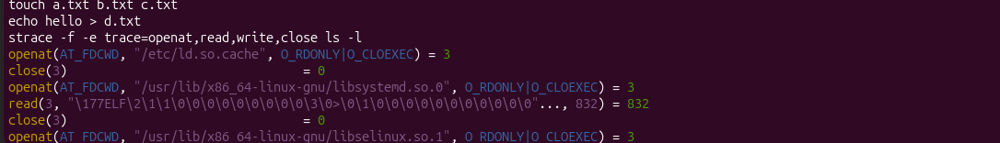
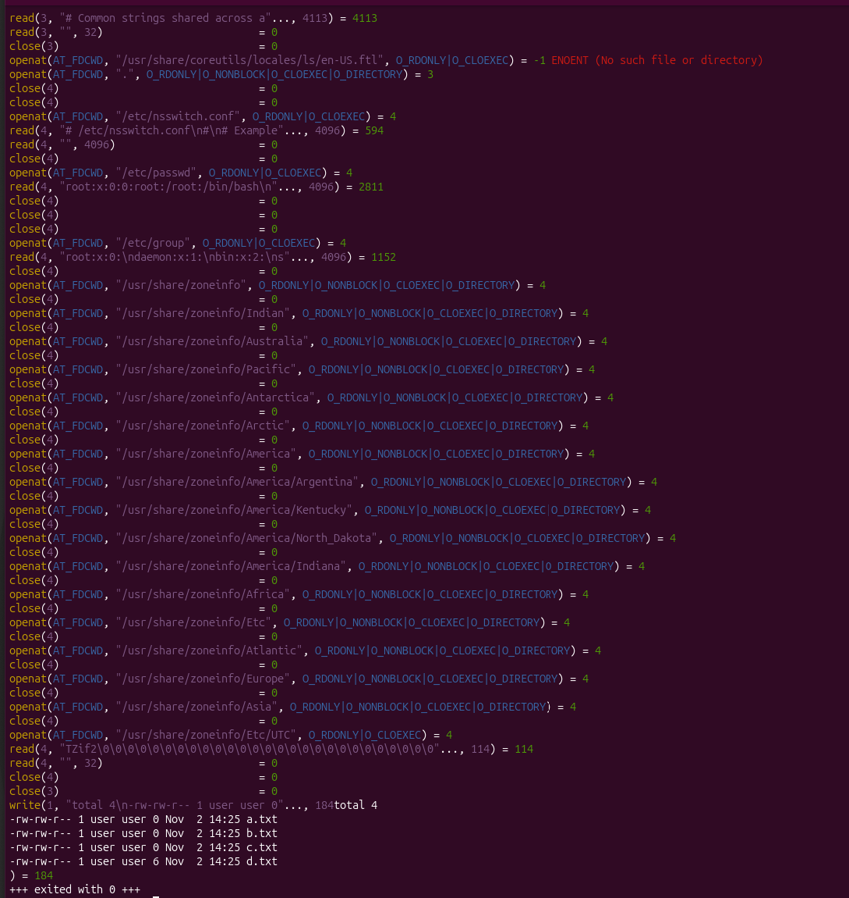
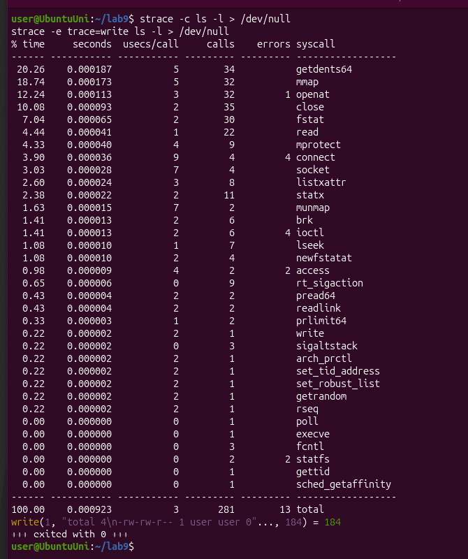
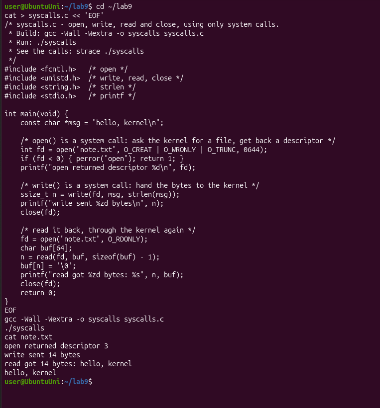
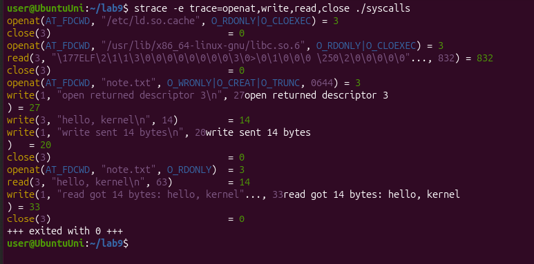
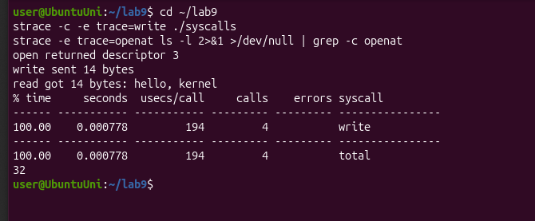

# Lab 9 – Watching System Calls with strace (Linux)

## Purpose of the work

The purpose of this lab is to watch the "door" between a program and the kernel, the system call. I used `strace`, which prints every system call that a program makes. First I looked at the calls of a real command (`ls -l`), then I wrote a small C program that uses `open`, `write` and `read` directly and watched its calls, and at the end I counted one kind of call.

I did the lab in Ubuntu running in VirtualBox, in a folder `~/lab9`. `strace` was already installed (version 6.19). The program is in the file `syscalls.c`.

## Part 1. The calls of a real command

I created four files in the folder (`a.txt`, `b.txt` and `c.txt` empty, and `d.txt` with the word `hello`) and ran `ls -l` under `strace`, showing only `openat`, `read`, `write` and `close`:

```
strace -f -e trace=openat,read,write,close ls -l
```



At the start I can see how `ls` loads its libraries: for each one there is an `openat`, then a `read` of 832 bytes (the start of the ELF file) and a `close`. This is the start-up of the program, before it does anything with my folder.



In this part `ls` first looks for a translation file `ls/en-US.ftl`, which does not exist (`-1 ENOENT`). Then it opens `.` (the folder itself), then `/etc/nsswitch.conf`, `/etc/passwd` and `/etc/group`, because `-l` shows the owner and the group as names (`user`) and the files only store numbers. It also opens many folders under `/usr/share/zoneinfo`, probably to find the time zone for the dates. At the very end there is only one `write`, and it prints the whole listing.

To count the calls I used `strace -c`, which prints a summary table:

```
strace -c ls -l > /dev/null
```



One simple `ls -l` made **281 system calls** in total (13 of them failed with an error). Most of them are the start-up of the program (`mmap`, `openat`, `close`, `fstat`) and the reading of the directory (`getdents64`, 34 calls). The `write` appears only **once**. The second command in the screenshot (`strace -e trace=write ls -l`) shows it:

```
write(1, "total 4\n-rw-rw-r-- 1 user user 0"..., 184) = 184
```

**Observe**

**1. Which system call does ls use to print to the screen? To which descriptor does it write?**

`ls` uses the system call `write`, and it writes to descriptor **1**, which is stdout (the screen). In my run it was a single call that sent the whole listing, 184 bytes (Figure 1.2 and the line above). The call returned 184, so all the bytes were accepted.

## Part 2. A program that calls the kernel directly

I typed the program `syscalls.c`. It opens `note.txt` for writing (with `O_CREAT | O_WRONLY | O_TRUNC`), writes the line `hello, kernel`, closes the file, opens it again for reading and reads the line back. `printf` is used only to show the numbers on the screen. I compiled it with the flags from the sheet and ran it:

```
gcc -Wall -Wextra -o syscalls syscalls.c
./syscalls
cat note.txt
```



It compiled without any warning and printed exactly the expected output: descriptor 3, 14 bytes written and 14 bytes read. `cat note.txt` shows the line `hello, kernel`, so the file was really created.

Then I ran it under `strace`:

```
strace -e trace=openat,write,read,close ./syscalls
```



At the end of the output are the calls of my program, the same as in the sheet:

- `openat(AT_FDCWD, "note.txt", O_WRONLY|O_CREAT|O_TRUNC, 0644) = 3`
- `write(3, "hello, kernel\n", 14) = 14`
- `close(3) = 0`
- `openat(AT_FDCWD, "note.txt", O_RDONLY) = 3`
- `read(3, "hello, kernel\n", 63) = 14`
- `close(3) = 0`

I also noticed that `open` became `openat` (it is the same call, the C library calls `openat` with `AT_FDCWD`, "the current folder"). The `read` asks for 63 bytes because my buffer has 64 bytes and I keep one for the `'\0'`. Between these lines there are also three `write(1, ...)` calls: they are my `printf` lines. So `printf` is not a system call, it is a library function that finishes with `write` on descriptor 1.

**Observe**

**1. The descriptor returned by the first openat is 3, not 0, 1 or 2. Why are those three already taken?**

Every process starts with three descriptors already open: 0 is stdin, 1 is stdout and 2 is stderr. They are opened by the shell (and the terminal) before my program starts, and they are kept when the shell does `fork` and `exec`. The rule is that `open` always returns the lowest free number. 0, 1 and 2 are taken, so the first free one is 3. The `strace` output confirms that 1 is the screen: my `printf` lines went out with `write(1, ...)`.

## Part 3. Count one kind of call

The sheet lists this part ("Count one kind of call", about 20 minutes) but there are no instructions for it in the PDF, so this is my own interpretation: I counted the `write` calls of my program and the `openat` calls of `ls -l`.

First I predicted the number of `write` calls of `./syscalls`. I counted three `printf` lines and one `write` to the file, so I expected 3 or 4. Then I checked it:

```
strace -c -e trace=write ./syscalls
strace -e trace=openat ls -l 2>&1 >/dev/null | grep -c openat
```



`./syscalls` made exactly **4** `write` calls (my prediction was right): three of them come from the three `printf` lines (to descriptor 1) and one is my `write(fd, ...)` to the file `note.txt` (to descriptor 3). `ls -l` made **32** `openat` calls, and in `strace -c` the same number appeared in the `openat` row. In the second command, `2>&1 >/dev/null` sends the text of `strace` (which goes to stderr) into `grep` and throws away the normal output of `ls`.

## Conclusions

In this lab I could see the system calls that I only knew from the lecture. A simple command like `ls -l` is not simple for the kernel: it made 281 system calls, but only one of them (`write` to descriptor 1) printed the result. My own program showed the calls that I wrote by hand (`open`, `write`, `read`, `close`), and that `printf` is only a library function that uses `write` under it.

I also understood why the first file gets descriptor 3: 0, 1 and 2 (stdin, stdout and stderr) are already open when a process starts, and `open` takes the lowest free number. The only problem was that Part 3 has no instructions in the sheet, so I did my own version of it (counting `write` and `openat` calls).
